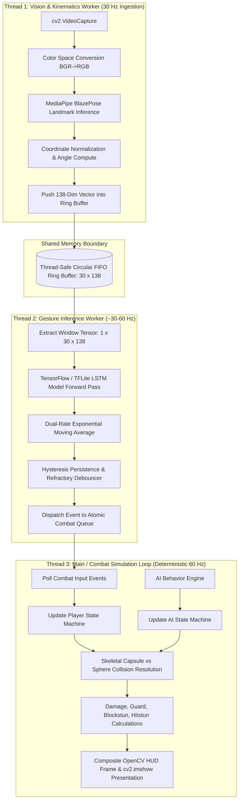
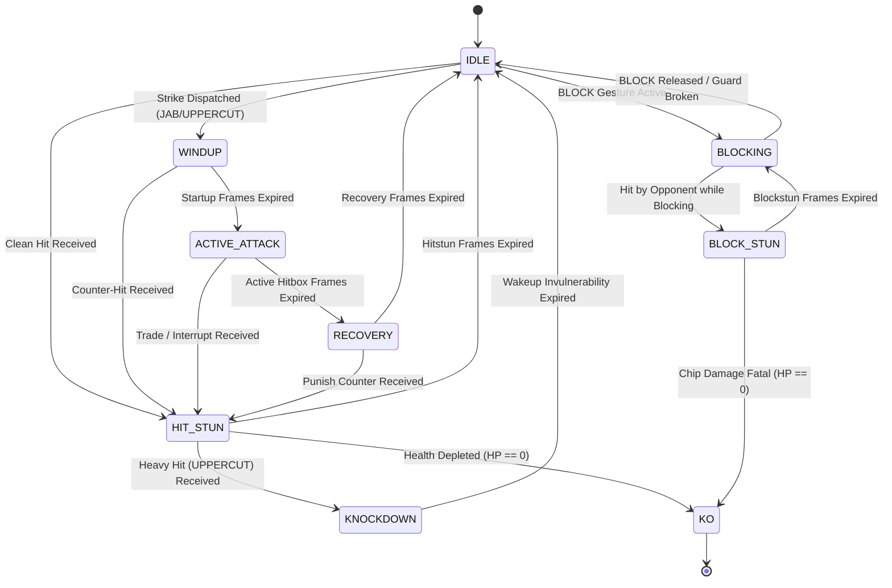

# Software Requirements Specification (SRS)
## Pose-Controlled Fighting Game System

**Standard:** ISO/IEC/IEEE 29148:2018 / IEEE Std 830-1998 Compliant  
**Document Identifier:** `SRS-PCFG-2026-V1.0`  
**Version:** 1.0.0  
**Status:** Approved for Baseline Implementation  
**Date of Release:** November 19, 2026  
**Authoring Body:** Engineering & System Architecture Specification Group (`srs_writer`, `srs_architect`)  
**Target Platform:** Python 3.10+, TensorFlow 2.x, MediaPipe BlazePose, OpenCV 4.x, NumPy, Scikit-learn  

---

## Executive Table of Contents

1. [Introduction](#1-introduction)
   - 1.1 [Purpose](#11-purpose)
   - 1.2 [Document Conventions & Requirement Typology](#12-document-conventions--requirement-typology)
   - 1.3 [Intended Audience & Reading Suggestions](#13-intended-audience--reading-suggestions)
   - 1.4 [Project Scope & System Overview](#14-project-scope--system-overview)
   - 1.5 [Technology Stack & Bill of Materials](#15-technology-stack--bill-of-materials)
   - 1.6 [Normative Standards & Applicable References](#16-normative-standards--applicable-references)
2. [Overall Description](#2-overall-description)
   - 2.1 [Product Perspective & Architectural Context](#21-product-perspective--architectural-context)
   - 2.2 [Product Functions & Decomposition](#22-product-functions--decomposition)
   - 2.3 [User Classes & Characteristics](#23-user-classes--characteristics)
   - 2.4 [Operating Environment & Host Requirements](#24-operating-environment--host-requirements)
   - 2.5 [Design & Implementation Constraints](#25-design--implementation-constraints)
   - 2.6 [Assumptions & Dependencies](#26-assumptions--dependencies)
3. [System Features & Detailed Functional Requirements](#3-system-features--detailed-functional-requirements)
   - 3.1 [Computer Vision & MediaPipe BlazePose Pipeline](#31-computer-vision--mediapipe-blazepose-pipeline)
   - 3.2 [Biomechanical Normalization & Coordinate Transformation](#32-biomechanical-normalization--coordinate-transformation)
   - 3.3 [Kinematic Feature Engineering & Temporal Windowing](#33-kinematic-feature-engineering--temporal-windowing)
   - 3.4 [Deep Learning Sequence Classifier (LSTM Subsystem)](#34-deep-learning-sequence-classifier-lstm-subsystem)
   - 3.5 [Dataset Management, Data Augmentation & Class Balancing](#35-dataset-management-data-augmentation--class-balancing)
   - 3.6 [Real-Time Inference, Probability Filtering & Debounce Engine](#36-real-time-inference-probability-filtering--debounce-engine)
   - 3.7 [Deterministic Combat Engine, State Machines & Collision](#37-deterministic-combat-engine-state-machines--collision)
   - 3.8 [Heuristic AI Opponent Engine & Difficulty Tuning](#38-heuristic-ai-opponent-engine--difficulty-tuning)
   - 3.9 [HUD Overlay, Visual FX & Audio/Telemetry Feedback](#39-hud-overlay-visual-fx--audiotelemetry-feedback)
4. [External Interface Requirements](#4-external-interface-requirements)
   - 4.1 [User Interfaces (UI) & Visual Presentation](#41-user-interfaces-ui--visual-presentation)
   - 4.2 [Hardware Interfaces (Webcam, Display, Processing Units)](#42-hardware-interfaces-webcam-display-processing-units)
   - 4.3 [Software Interfaces & Third-Party Library Integration](#43-software-interfaces--third-party-library-integration)
   - 4.4 [Inter-Process & Inter-Thread Communication Interfaces](#44-inter-process--inter-thread-communication-interfaces)
5. [Non-Functional Requirements (NFRs)](#5-non-functional-requirements-nfrs)
   - 5.1 [Performance, Throughput & End-to-End Latency Budget](#51-performance-throughput--end-to-end-latency-budget)
   - 5.2 [Classification Accuracy, Precision & Generalization Metrics](#52-classification-accuracy-precision--generalization-metrics)
   - 5.3 [Environmental, Lighting & Background Robustness](#53-environmental-lighting--background-robustness)
   - 5.4 [Usability, Ergonomics & Motion Fatigue Mitigation](#54-usability-ergonomics--motion-fatigue-mitigation)
   - 5.5 [Physical Safety, Space Envelope & Health Advisories](#55-physical-safety-space-envelope--health-advisories)
   - 5.6 [Software Reliability, Fault Tolerance & Exception Handling](#56-software-reliability-fault-tolerance--exception-handling)
6. [Verification, Validation & Acceptance Criteria Matrix (Traceability Matrix)](#6-verification-validation--acceptance-criteria-matrix-traceability-matrix)

---

## 1. Introduction

### 1.1 Purpose
This Software Requirements Specification (SRS) establishes the formal, binding, and verifiable requirements for the **Pose-Controlled Fighting Game System (PCFG)**. It specifies the behavioral, functional, mathematical, algorithmic, architectural, and non-functional requirements necessary to implement, verify, validate, and maintain a real-time, vision-driven boxing/fighting combat video game.

The system utilizes an off-the-shelf monocular 2D RGB camera to extract 3D human kinematics, classify dynamic martial arts gestures via deep recurrent neural networks, and execute deterministic combat simulations against an artificial intelligence opponent without requiring specialized depth sensors, accelerometers, or wearable markers.

### 1.2 Document Conventions & Requirement Typology
This specification adheres to the structural guidelines of **ISO/IEC/IEEE 29148:2018** (Systems and software engineering — Life cycle processes — Requirements engineering) and **IEEE Std 830-1998** (Recommended Practice for Software Requirements Specifications).

#### 1.2.1 Normative Verbs (RFC 2119 / ISO/IEC Directives)
- **SHALL / MUST:** Denotes an absolute, mandatory requirement without exception.
- **SHOULD / RECOMMENDED:** Denotes a strong design recommendation or best practice; non-compliance requires documented architectural justification.
- **MAY / OPTIONAL:** Denotes a truly optional or configurable feature.
- **SHALL NOT / MUST NOT:** Denotes an explicit architectural or security prohibition.

#### 1.2.2 Requirement Identifier Taxonomy
Every atomic requirement within Section 3, Section 4, and Section 5 is uniquely cataloged according to the following hierarchical naming schema:
```
REQ-[CATEGORY]-[SUBSYSTEM]-[001...999]
```
Where `[CATEGORY]` is one of:
- `FUNC`: Functional Requirement
- `INTF`: External Interface Requirement
- `NFR`: Non-Functional Requirement
- `SAFE`: Safety & Physical Play Area Requirement

And `[SUBSYSTEM]` designates the functional domain (e.g., `POSE`, `NORM`, `FEAT`, `LSTM`, `DATA`, `INFER`, `COMBAT`, `AI`, `HUD`, `PERF`, `ACC`).

### 1.3 Intended Audience & Reading Suggestions
This document is authored for:
1. **Machine Learning Engineers & Data Scientists:** Consult Section 3.1 through Section 3.6 for landmark tracking, 3D normalization mathematics, feature engineering, LSTM topology, and loss formulation.
2. **Game Engine & Combat Mechanics Programmers:** Consult Section 3.7 through Section 3.9 for frame data, collision detection geometry, state machines, and OpenCV HUD compositing.
3. **Software Architecture & Systems Engineers:** Consult Section 1.5, Section 2.1, Section 4.4, and Section 5.1 for concurrency pipelines, latency budgets, and memory ring buffers.
4. **Quality Assurance & Verification Teams:** Consult Section 6 for the exhaustive Acceptance Criteria and Requirements Traceability Matrix (RTM).

### 1.4 Project Scope & System Overview
The Pose-Controlled Fighting Game operates on consumer-tier computing workstations. The system continuously ingests video frames from a commodity RGB webcam at $\ge 30\text{ frames per second (FPS)}$, tracks 33 human skeletal landmarks via MediaPipe BlazePose, normalizes user anatomical dimensions to ensure absolute scale, translation, and yaw invariance, and extracts a 138-dimensional spatio-temporal kinematic feature vector.

A circular FIFO ring buffer captures a rolling 30-frame temporal window ($1.0\text{ s}$ duration) feeding a causal unidirectional Long Short-Term Memory (LSTM) sequence classifier. The classifier discriminates among four discrete action states:
1. `NONE` (Neutral stance, footwork, non-combat motion)
2. `JAB` (Rapid linear punch extension)
3. `UPPERCUT` (Upward vertical power strike)
4. `BLOCK` (Bilateral high guard protecting the head)

Detected gestures are post-processed through an Exponential Moving Average (EMA) smoothing filter, evaluated against class-tailored confidence thresholds, passed through temporal persistence hysteresis, and throttled by a refractory debounce engine. Accepted actions are dispatched to a deterministic 60 Hz combat engine featuring standard frame data (startup, active, recovery), capsule-to-sphere collision detection, guard mitigation, hitstun, combo counters, and an AI opponent possessing configurable reactive difficulty behaviors.


### 1.5 Technology Stack & Bill of Materials

| Component / Subsystem | Technology Selection | Version Constraint | Justification & Architectural Role |
|---|---|---|---|
| **Core Runtime** | Python | $\ge 3.10.x, < 3.12$ | Modern type annotations, async primitives, high-performance C-extensions. |
| **Computer Vision Engine** | Google MediaPipe | $\ge 0.10.8$ | BlazePose GHUM 3D skeletal topology, real-time CPU/GPU landmark inference. |
| **Deep Learning Framework** | TensorFlow / Keras | $\ge 2.14.0, \le 2.16.x$ | LSTM sequence classification, exportable to TensorFlow Lite (TFLite) runtime. |
| **Image Processing & GUI** | OpenCV (Open Source Computer Vision) | $\ge 4.8.0$ | `cv2.VideoCapture` UVC camera streaming, image matrix manipulation, HUD drawing. |
| **Numerical Processing** | NumPy | $\ge 1.24.0, < 2.0.0$ | Vectorized SIMD matrix transformations, circular ring buffers, tensor ops. |
| **Dataset & Metrics Engine** | Scikit-learn | $\ge 1.3.0$ | Stratified train/val/test splits, confusion matrices, F1/Precision/Recall scoring. |
| **Hardware Architecture** | x86_64 / ARM64 (Apple Silicon) | Dual-core CPU min, Quad-core rec | Minimum AVX2 instruction support on x86, NEON acceleration on Apple M-series. |
| **Camera Hardware** | USB UVC 1.1 / Integrated | 720p (1280x720) @ 30 FPS | Standard consumer laptop or desktop webcam. |

### 1.6 Normative Standards & Applicable References
1. **ISO/IEC/IEEE 29148:2018:** Systems and software engineering — Life cycle processes — Requirements engineering.
2. **IEEE Std 830-1998:** IEEE Recommended Practice for Software Requirements Specifications.
3. **RFC 2119:** Key words for use in RFCs to Indicate Requirement Levels (IETF).
4. **MediaPipe BlazePose Research:** Bazrevsky et al., *"BlazePose: On-device Real-time Body Pose Tracking"*, CVPR 2020.
5. **Technical Architecture Baseline:** `docs/technical_architecture.md`, Version 1.0.0 (System Architecture Group).

---

## 2. Overall Description

### 2.1 Product Perspective & Architectural Context
The Pose-Controlled Fighting Game operates as a self-contained, standalone desktop application. It interfaces directly with local operating system hardware drivers for video capture and window presentation. The software follows a decoupled, multi-threaded producer-consumer concurrency model to guarantee that camera ingestion jitter does not degrade game combat simulation determinism.



### 2.2 Product Functions & Decomposition
The high-level functional capabilities of the system comprise:
1. **Real-Time Video Capture:** High-efficiency, zero-copy ingestion of camera frames via OpenCV with internal driver buffer depths locked to 1 frame to eliminate stale-frame latency.
2. **3D Skeletal Landmark Extraction:** Execution of MediaPipe BlazePose extracting 33 topological 3D landmark points $(x, y, z)$ with associated presence and visibility probabilities.
3. **Anatomical Scale & Translation Invariance:** Transformation of raw screen coordinates into a normalized human coordinate space centered at the mid-hip point and scaled by torso Euclidean length.
4. **Kinematic Feature Engineering:** Dynamic computation of first-derivative velocities for key combat effectors (wrists, elbows, shoulders, head) and biomechanical interior joint angles.
5. **Causal Temporal Windowing:** Continuous aggregation of normalized kinematic vectors into an in-memory sliding temporal FIFO buffer representing the preceding 1000 milliseconds of movement.
6. **Deep Sequence Classification:** Continuous forward-pass evaluation of causal unidirectional Long Short-Term Memory (LSTM) layers producing probability distributions across `NONE`, `JAB`, `UPPERCUT`, and `BLOCK`.
7. **Signal Conditioning & Debouncing:** Multi-tier post-processing using asymmetric exponential smoothing, class-specific confidence barriers, consecutive frame persistence checks, and lockout timers.
8. **Deterministic 60 Hz Combat Simulation:** Execution of a fixed-timestep fighting game combat engine with discrete attack phases (startup, active, recovery), guard mitigation, and damage allocation.
9. **Heuristic AI Combat Opponent:** Hierarchical state-machine AI simulating human reaction times, telegraphing unblockable strikes, and executing punishing counter-attacks across three selectable difficulty levels.
10. **Dynamic OpenCV HUD & Audio-Visual Feedback:** Layered rendering of the mirror-image camera stream, skeletal wireframe tracking, fist glow states, dynamic health bars, guard meters, combo hit counts, and particle spark explosions.

### 2.3 User Classes & Characteristics

| User Class | Physical / Technical Profile | Expected Interaction & System Demands |
|---|---|---|
| **Casual Gamer** | Non-technical end user; interacts standing or seated; may lack martial arts form. | Demands lenient gesture recognition, immediate visual feedback, forgiving timing, and engaging arcade HUD aesthetics. |
| **Martial Arts Enthusiast** | Athletic user; executes rapid, technically crisp strikes with high angular velocity. | Requires tight frame data, zero-latency responsiveness, distinct counter-hit mechanics, and rigorous hitbox accuracy. |
| **Accessibility / Ergonomic User** | User with varying physical reach, torso proportions, or slight mobility differences. | Demands robust scale invariance that does not penalize shorter reach or standing distance variance. |
| **Developer / QA Analyst** | Technical operator maintaining codebase, tuning neural weights, or running automated unit tests. | Demands real-time telemetry overlays, FPS/latency profiling monitors, head-up debug logs, and data recording hooks. |

### 2.4 Operating Environment & Host Requirements
The system SHALL operate under the following minimum and recommended host execution environments:

- **Host Operating Systems:**
  - macOS 12.0 (Monterey) through macOS 15.x (Sequoia) on Apple Silicon (M1/M2/M3/M4) or x86_64.
  - Microsoft Windows 10 / 11 (64-bit).
  - Ubuntu Linux 20.04 / 22.04 LTS (x86_64).
- **CPU:** Dual-Core 2.4 GHz x86_64 (with AVX2 support) or Apple Silicon ARM64. (Recommended: Quad-Core 3.0 GHz+).
- **RAM:** Minimum 4.0 GB free physical RAM; Recommended 8.0 GB.
- **Camera Sensor:** USB 2.0/3.0 UVC Video Class compliant webcam supporting 720p (1280x720) at 30 FPS.
- **Display Resolution:** Minimum $1280 \times 720$ progressive display running at 60 Hz refresh rate.

### 2.5 Design & Implementation Constraints
- **CON-01 (Sensor Agnosticism):** The software SHALL NOT require specialized depth hardware (e.g., Microsoft Kinect, Intel RealSense) or wearable inertial sensors (IMUs). All kinematics must derive strictly from a single 2D monocular RGB stream.
- **CON-02 (Zero Acausal Lookahead):** In real-time gameplay inference, the sequence classifier MUST be causal. Bidirectional recurrent layers (BiLSTM) or future-frame temporal convolutions are strictly prohibited.
- **CON-03 (Single-User Focus):** The system SHALL track and process kinematics for exactly one active combatant in the camera field of view. Multi-person tracking is explicitly outside the combat scope.
- **CON-04 (Compute Footprint):** Total CPU utilization SHALL NOT exceed 75% on a standard quad-core consumer processor to prevent thermal throttling and audio/video frame dropping.
- **CON-05 (Memory Cap):** Maximum resident working set memory SHALL NOT exceed 1.5 GB during active gameplay.

### 2.6 Assumptions & Dependencies
- **ASM-01 (Field of View):** The user stands between 1.5 meters and 2.5 meters from the webcam, ensuring the upper body (head, shoulders, elbows, wrists, and hips) remains continuously unoccluded within the camera frustum.
- **ASM-02 (Lighting Conditions):** The ambient play space maintains minimum diffused illumination of $\ge 150\text{ lux}$ without direct high-intensity backlighting blinding the sensor.
- **DEP-01 (MediaPipe Weights):** System depends on Google MediaPipe's pre-trained BlazePose landmark model assets.
- **DEP-02 (TFLite / TensorFlow Runtime):** System depends on TensorFlow C++/Python runtime libraries for recurrent neural network evaluation.

---

## 3. System Features & Detailed Functional Requirements

### 3.1 Computer Vision & MediaPipe BlazePose Pipeline

```
+---------------------------------------------------------------------------------------------------+
| MediaPipe BlazePose Pipeline: Ingestion -> BGR/RGB -> 3D Inference -> Confidence Filtering        |
+---------------------------------------------------------------------------------------------------+
```

#### REQ-FUNC-POSE-001: Video Ingestion & Camera Driver Configuration
The system SHALL ingest raw video frames from a standard USB UVC webcam using OpenCV `cv2.VideoCapture`. The video stream SHALL be configured to an aspect ratio of 16:9 at a resolution of $1280 \times 720$ pixels at $\ge 30\text{ FPS}$. To prevent frame accumulation latency, the underlying capture driver buffer size SHALL be set via `cv2.CAP_PROP_BUFFERSIZE = 1`.

#### REQ-FUNC-POSE-002: Color Space Transformation & Preprocessing
The system SHALL convert each ingested frame from OpenCV default BGR channel ordering to RGB channel ordering prior to invoking the MediaPipe inference graph. The memory buffer passed to MediaPipe SHALL be contiguous and marked read-only during inference to avoid memory thrashing.

#### REQ-FUNC-POSE-003: 3D Skeletal Landmark Topology
The system SHALL extract 33 discrete 3D anatomical skeletal landmarks per frame conforming to the Google MediaPipe BlazePose GHUM topology. Each extracted landmark $i \in \{0, \dots, 32\}$ SHALL comprise a 4-tuple:
$$L_i = (x_i, y_i, z_i, v_i)$$
where $x_i, y_i \in [0.0, 1.0]$ represent normalized image coordinates, $z_i$ represents relative anatomical depth relative to the mid-hip point, and $v_i \in [0.0, 1.0]$ represents visibility confidence.

```
Landmark Partitioning Index Map:
 0: Nose (Head Anchor)
11: Left Shoulder   12: Right Shoulder
13: Left Elbow      14: Right Elbow
15: Left Wrist      16: Right Wrist
19: Left Index      20: Right Index
23: Left Hip        24: Right Hip
25: Left Knee       26: Right Knee
27: Left Ankle      28: Right Ankle
```

#### REQ-FUNC-POSE-004: Visibility Thresholding & Low-Confidence Filtering
The system SHALL evaluate the visibility confidence $v_i$ for all landmarks. If $v_i < \tau_v$ where threshold $\tau_v = 0.50$, the landmark SHALL be flagged as occluded. If the occluded landmark was validly tracked within the previous $k=3$ frames, the system SHALL impute its coordinate via first-order kinematic forward extrapolation:
$$\hat{L}_i(t) = L_i(t-1) + \vec{V}_i(t-1)$$
If occlusion persists for $> 3$ consecutive frames, the system SHALL interpolate the landmark position toward the resting anatomical neutral posture.

---

### 3.2 Biomechanical Normalization & Coordinate Transformation

```
Raw Landmark L_i -> [Translation Centering] -> [Scale Invariance] -> [Yaw Rotation Correction] -> N_i
```

#### REQ-FUNC-NORM-001: Translation Invariance via Mid-Hip Centering
To eliminate positional bias caused by where the player stands in the webcam frame, the system SHALL compute the mid-hip root anchor $C_{\text{hip}}$ from Left Hip ($L_{23}$) and Right Hip ($L_{24}$):
$$C_{\text{hip}} = \frac{L_{23} + L_{24}}{2} = \left(\frac{x_{23}+x_{24}}{2}, \frac{y_{23}+y_{24}}{2}, \frac{z_{23}+z_{24}}{2}\right)$$
The system SHALL subtract $C_{\text{hip}}$ from every landmark coordinate:
$$L'_i = L_i - C_{\text{hip}} = (x_i - x_{\text{hip}}, y_i - y_{\text{hip}}, z_i - z_{\text{hip}})$$

#### REQ-FUNC-NORM-002: Anatomical Scale Invariance via Torso Euclidean Metric
To ensure identical feature representations across users of varying heights, limb lengths, and camera distances, the system SHALL calculate the torso reference baseline length $S_{\text{torso}}$, defined as the 3D Euclidean distance between the shoulder midpoint $C_{\text{shoulder}}$ and hip midpoint $C_{\text{hip}}$:
$$C_{\text{shoulder}} = \frac{L_{11} + L_{12}}{2}$$
$$S_{\text{torso}} = \|C_{\text{shoulder}} - C_{\text{hip}}\|_2 = \sqrt{(x_{\text{sh}} - x_{\text{hip}})^2 + (y_{\text{sh}} - y_{\text{hip}})^2 + (z_{\text{sh}} - z_{\text{hip}})^2}$$
To prevent division-by-zero singularities during tracking dropouts, the system SHALL apply a guard ceiling:
$$S_{\text{norm}} = \max(S_{\text{torso}}, 10^{-6})$$
Every translated landmark coordinate SHALL be scaled by $S_{\text{norm}}$:
$$L''_i = \frac{L'_i}{S_{\text{norm}}}$$

#### REQ-FUNC-NORM-003: Coronal Plane & Yaw Rotation Normalization
To prevent misclassifications when players stand in an orthodox or southpaw combat stance angled relative to the camera, the system SHALL compute the coronal yaw angle $\theta_{\text{yaw}}$ of the shoulder vector $\vec{V}_{\text{shoulder}} = L''_{12} - L''_{11}$:
$$\theta_{\text{yaw}} = \operatorname{atan2}(z''_{12} - z''_{11}, x''_{12} - x''_{11})$$
The system SHALL rotate all scaled coordinates $L''_i$ around the vertical $Y$-axis by $-\theta_{\text{yaw}}$ using the 3D rotation matrix $R_y$:
$$R_y(-\theta_{\text{yaw}}) = \begin{bmatrix} \cos(-\theta_{\text{yaw}}) & 0 & \sin(-\theta_{\text{yaw}}) \\ 0 & 1 & 0 \\ -\sin(-\theta_{\text{yaw}}) & 0 & \cos(-\theta_{\text{yaw}}) \end{bmatrix}$$
$$L'''_i = R_y(-\theta_{\text{yaw}}) \cdot L''_i$$
The resulting normalized coordinates $L'''_i$ SHALL be strictly scale-, translation-, and yaw-invariant.

---

### 3.3 Kinematic Feature Engineering & Temporal Windowing

#### REQ-FUNC-FEAT-001: 138-Dimensional Feature Vector Construction
At every frame $t$, the system SHALL synthesize a dense 1D feature vector $F_t \in \mathbb{R}^{138}$ combining positional coordinates, temporal derivatives, and joint flexion angles:

```
+---------------------------------------------------------------------------------------------------+
|                                  Feature Vector F_t (D = 138 dims)                                |
+-----------------------------------+-----------------------------------+---------------------------+
|  Position Features (99 dims)      |  Velocity Features (33 dims)      |  Angular Features (6 dims)|
|  33 landmarks x (x, y, z) coords  |  11 key upper-body landmarks x    |  Joint flexion & torso    |
|  Normalized & centered            |  (vx, vy, vz) first derivatives   |  biomechanical angles     |
+-----------------------------------+-----------------------------------+---------------------------+
```

1. **Normalized Positional Block ($99\text{ dimensions}$):**
   $$F_{\text{pos}}(t) = [x'''_0, y'''_0, z'''_0, \dots, x'''_{32}, y'''_{32}, z'''_{32}] \in \mathbb{R}^{99}$$
2. **First-Derivative Kinematic Velocities ($33\text{ dimensions}$):**
   Computed across the 11 critical upper-body martial landmarks $\mathcal{K} = \{0, 11, 12, 13, 14, 15, 16, 19, 20, 23, 24\}$:
   $$\vec{V}_i(t) = \frac{L'''_i(t) - L'''_i(t-1)}{\Delta t}$$
   $$F_{\text{vel}}(t) = [\vec{V}_0(t), \vec{V}_{11}(t), \dots, \vec{V}_{24}(t)] \in \mathbb{R}^{33}$$
3. **Biomechanical Joint Angles ($6\text{ dimensions}$):**
   Computed using the 3D vector dot product across adjacent limb vectors:
   $$\theta_{ABC} = \arccos\left(\frac{\vec{BA} \cdot \vec{BC}}{\|\vec{BA}\|_2 \|\vec{BC}\|_2}\right)$$
   The 6 calculated angles SHALL be:
   - Left Elbow Flexion ($\theta_{15-13-11}$)
   - Right Elbow Flexion ($\theta_{16-14-12}$)
   - Left Shoulder Abduction ($\theta_{13-11-23}$)
   - Right Shoulder Abduction ($\theta_{14-12-24}$)
   - Left Hip Stance Angle ($\theta_{11-23-25}$)
   - Right Hip Stance Angle ($\theta_{12-24-26}$)
   $$F_{\text{angle}}(t) = [\theta_{\text{LE}}, \theta_{\text{RE}}, \theta_{\text{LS}}, \theta_{\text{RS}}, \theta_{\text{LH}}, \theta_{\text{RH}}] \in \mathbb{R}^6$$

#### REQ-FUNC-FEAT-002: Sliding Window Circular FIFO Ring Buffer
The system SHALL maintain an in-memory thread-safe circular FIFO buffer holding exactly $T = 30$ historical feature vectors ($1.0\text{ second}$ of motion history at $30\text{ FPS}$). 
- At every newly processed camera frame, $F_t$ SHALL be pushed to the buffer, evicting the oldest vector $F_{t-30}$.
- The buffer SHALL output a contiguous memory tensor of shape $(1, 30, 138)$ with data type `float32` for downstream model inference.
- Upon system startup or tracking loss reset, the buffer SHALL be prefilled with 30 synthetic neutral standing pose vectors to prevent undefined memory access.

---

### 3.4 Deep Learning Sequence Classifier (LSTM Subsystem)

#### REQ-FUNC-LSTM-001: Causal Unidirectional Recurrent Topology
The gesture classifier SHALL be implemented as a causal unidirectional recurrent neural network. The neural network SHALL NOT use bidirectional layers (BiLSTM), acausal temporal convolutions, or transformer architectures with future lookahead masks.

#### REQ-FUNC-LSTM-002: Layer Connectivity & Hyperparameter Specification
The model architecture SHALL conform to the following layer graph:

```
Input Tensor: (Batch=1, Timesteps=30, Features=138)
      │
      ▼
┌────────────────────────────────────────────────────────┐
│ Masking Layer (mask_value = 0.0)                       │
└────────────────────────────────────────────────────────┘
      │
      ▼
┌────────────────────────────────────────────────────────┐
│ LSTM Layer 1: 128 Units, return_sequences=True         │
│ Activation: tanh, Recurrent Activation: sigmoid        │
└────────────────────────────────────────────────────────┘
      │
      ▼
┌────────────────────────────────────────────────────────┐
│ Spatial / Recurrent Dropout (rate = 0.25)              │
│ LayerNormalization (axis = -1, epsilon = 1e-5)         │
└────────────────────────────────────────────────────────┘
      │
      ▼
┌────────────────────────────────────────────────────────┐
│ LSTM Layer 2: 64 Units, return_sequences=False        │
│ Activation: tanh, Recurrent Activation: sigmoid        │
└────────────────────────────────────────────────────────┘
      │
      ▼
┌────────────────────────────────────────────────────────┐
│ Dropout (rate = 0.30)                                  │
│ BatchNormalization (momentum = 0.99)                   │
└────────────────────────────────────────────────────────┘
      │
      ▼
┌────────────────────────────────────────────────────────┐
│ Dense Layer: 64 Units, activation = 'relu', L2 = 1e-4  │
│ Dropout (rate = 0.20)                                  │
└────────────────────────────────────────────────────────┘
      │
      ▼
┌────────────────────────────────────────────────────────┐
│ Output Layer: 4 Units, activation = 'softmax'          │
│ Classes: [0: NONE, 1: JAB, 2: UPPERCUT, 3: BLOCK]      │
└────────────────────────────────────────────────────────┘
```

#### REQ-FUNC-LSTM-003: Model Parameter & Footprint Budget
The total trainable and non-trainable parameter count of the model SHALL NOT exceed $200,000$ parameters (nominal target: $190,788$ parameters, occupying $\le 800\text{ KB}$ in FP32 format or $\le 200\text{ KB}$ in quantized INT8 format).

#### REQ-FUNC-LSTM-004: Execution Latency Ceiling
A single forward-pass inference of the model given input tensor $(1, 30, 138)$ on a standard quad-core CPU SHALL execute within $\le 5.0\text{ milliseconds}$.

---

### 3.5 Dataset Management, Data Augmentation & Class Balancing

#### REQ-FUNC-DATA-001: Target Action Class Taxonomy
The system SHALL classify human upper-body movements into exactly four mutually exclusive tactical classes:

| Class ID | Class Label | Biomechanical Trigger Signature | Minimum Duration |
|---|---|---|---|
| `0` | `NONE` | Neutral stance, ducking, footwork, non-combat gestures. | Continuous |
| `1` | `JAB` | Rapid forward extension of lead/rear fist along $Z$-axis, elbow angle $\theta_{\text{elbow}} > 155^\circ$. | $\ge 2$ frames |
| `2` | `UPPERCUT` | Ascending vertical strike ($+Y$ in body space), elbow flexed between $70^\circ - 110^\circ$, rising shoulder. | $\ge 3$ frames |
| `3` | `BLOCK` | Both wrists elevated in front of nose/face, elbows tucked covering chest/ribs. | $\ge 4$ frames |

#### REQ-FUNC-DATA-002: Subject-Stratified Dataset Splitting Protocol
To eliminate cross-subject data leakage and guarantee that the model learns generalized biomechanics rather than individual user clothing or proportions:
- The training split SHALL comprise 70% of total sequences gathered across Subjects 1 through $N_{\text{train}}$.
- The validation split SHALL comprise 15% of total sequences gathered across disjoint Subjects $N_{\text{train}}+1$ through $N_{\text{val}}$.
- The held-out test split SHALL comprise 15% of total sequences gathered across unseen Subjects $N_{\text{val}}+1$ through $N_{\text{total}}$.
- Sequences from the same individual human subject SHALL NEVER appear in both training and evaluation splits.

#### REQ-FUNC-DATA-003: Stochastic Spatial Augmentation Pipeline
During offline dataset training, the training engine SHALL apply real-time spatial transformations:
1. **3D Yaw and Roll Rotations:** Random rotation around $Y$-axis ($\theta_{\text{yaw}} \sim \mathcal{U}(-15^\circ, +15^\circ)$) and $Z$-axis ($\theta_{\text{roll}} \sim \mathcal{U}(-8^\circ, +8^\circ)$).
2. **Anatomical Scale Jitter:** Uniform scaling of coordinates by factor $s \sim \mathcal{U}(0.85, 1.15)$.
3. **Bilateral Mirroring (Orthodox / Southpaw Inversion):** Negating the $X$-coordinate ($x \leftarrow -x$) while simultaneously swapping bilateral landmark indices (Left Shoulder $11 \leftrightarrow 12$ Right Shoulder, Left Elbow $13 \leftrightarrow 14$ Right Elbow, Left Wrist $15 \leftrightarrow 16$ Right Wrist, etc.).

#### REQ-FUNC-DATA-004: Stochastic Temporal & Noise Augmentation Pipeline
During offline dataset training, the training engine SHALL apply temporal distortions:
1. **Kinematic Time-Warping:** Resampling the 30-frame sequence over a randomized virtual duration $T_{\text{virtual}} \in [24, 38]$ frames via cubic spline interpolation.
2. **Temporal Window Shifting:** Jittering the impact peak frame within the 30-frame window by an offset $\delta \sim \mathcal{U}(-4, +4)$ frames.
3. **Sensor Jitter Injection:** Adding zero-mean Gaussian noise $\epsilon \sim \mathcal{N}(0, 0.01^2)$ to normalized coordinates.
4. **Synthetic Landmark Dropout:** Setting random limb landmarks to zero with probability $p=0.05$ to train robustness against camera occlusions.

#### REQ-FUNC-DATA-005: Multi-Class Focal Loss Formulation
To counteract class imbalance resulting from players remaining in `NONE` $> 75\%$ of the time, the model SHALL be trained using multi-class Focal Loss:
$$\mathcal{L}_{\text{focal}} = - \sum_{c=0}^{3} \alpha_c \, (1 - p_c)^\gamma \, y_c \, \log(p_c)$$
where $\gamma = 2.0$ downweights easy negative idle frames, $y_c$ is one-hot ground truth, $p_c$ is softmax probability, and $\alpha_c$ is the inverse frequency class weight ($w_{\text{NONE}} \approx 0.35, w_{\text{BLOCK}} \approx 1.25, w_{\text{JAB}} \approx 1.25, w_{\text{UPPERCUT}} \approx 2.50$).

---

### 3.6 Real-Time Inference, Probability Filtering & Debounce Engine

```
Raw Softmax -> [EMA Smoothing] -> [Class Threshold Filter] -> [Persistence Hysteresis] -> [Debounce Gate] -> Dispatch
```

#### REQ-FUNC-INFER-001: Asymmetric Exponential Moving Average (EMA) Filtering
The system SHALL filter the raw output probability vector $P_t$ from the LSTM softmax layer using an Exponential Moving Average filter:
$$\hat{P}_t = \alpha P_t + (1 - \alpha) \hat{P}_{t-1}$$
The smoothing factor $\alpha$ SHALL be dynamically parameterized based on action dynamics:
- For ballistic strike gestures (`JAB`, `UPPERCUT`): $\alpha = 0.65$ (prioritizing low latency; responsive within $\le 1.5$ frames).
- For sustained defensive states (`BLOCK`, `NONE`): $\alpha = 0.40$ (prioritizing noise suppression and anti-flicker stability).

#### REQ-FUNC-INFER-002: Class-Specific Confidence Thresholds ($\tau_c$)
The system SHALL NOT use a uniform 0.50 threshold. An action candidate SHALL be considered detected only when its smoothed probability $\hat{P}_t(c)$ meets or exceeds its dedicated threshold $\tau_c$:

| Class Label | Confidence Threshold ($\tau_c$) | Rationale |
|---|---|---|
| `NONE` | $0.50$ | Default resting condition. |
| `JAB` | $0.80$ | High threshold prevents accidental arm extensions from triggering attacks. |
| `UPPERCUT` | $0.85$ | Maximum threshold prevents natural rising body motions from firing heavy strikes. |
| `BLOCK` | $0.75$ | Balanced threshold allows rapid, reliable defensive guard entry. |

#### REQ-FUNC-INFER-003: Multi-Frame Temporal Persistence (Hysteresis)
To prevent single-frame sensor anomalies or transient video dropped packets from dispatching false strikes, an action candidate SHALL sustain $\hat{P}_t(c) \ge \tau_c$ for a minimum number of consecutive frames $N_{\text{min}}(c)$ before the event is confirmed:
- `JAB`: $N_{\text{min}} = 2$ consecutive frames ($66.7\text{ ms}$).
- `UPPERCUT`: $N_{\text{min}} = 3$ consecutive frames ($100.0\text{ ms}$).
- `BLOCK`: $N_{\text{min}} = 4$ consecutive frames ($133.3\text{ ms}$).
If $\hat{P}_t(c)$ drops below $\tau_c \times 0.85$, the consecutive streak counter SHALL immediately reset to zero.

#### REQ-FUNC-INFER-004: Refractory Debounce Cooldown Timers
Once a discrete attack event (`JAB` or `UPPERCUT`) is dispatched to the combat engine, the debounce engine SHALL lock out subsequent triggers of that attack for a refractory period $T_{\text{cooldown}}$:
- `JAB` Cooldown: $450\text{ ms}$ (~14 frames at 30 FPS).
- `UPPERCUT` Cooldown: $650\text{ ms}$ (~20 frames at 30 FPS).
- `BLOCK` State: Held continuously while the user maintains high guard; exits immediately upon dropping hands without cooldown.

---

### 3.7 Deterministic Combat Engine, State Machines & Collision

#### REQ-FUNC-COMBAT-001: Fixed 60 Hz Simulation Timestep
The combat simulation engine SHALL update at a fixed, deterministic frequency of $60\text{ Hz}$ ($\Delta t = 16.667\text{ ms}$), decoupled from the variable camera frame ingestion thread (which operates at $\approx 30\text{ FPS}$) and decoupled from monitor display V-Sync using a standard accumulator timing loop.

#### REQ-FUNC-COMBAT-002: Player Combat Finite State Machine (FSM)
The player combat state SHALL transition strictly according to the following deterministic FSM:



#### REQ-FUNC-COMBAT-003: Frame Data Specifications (Standard 60 Hz Timesteps)
All player and AI attacks SHALL be partitioned into discrete, inviolable frame data phases:

| Move | Startup (Frames / ms) | Active (Frames / ms) | Recovery (Frames / ms) | Total (Frames / ms) | On-Hit Adv. | On-Block Adv. | Base Damage | Chip Damage |
|---|---|---|---|---|---|---|---|---|
| **JAB** | 6 frames (100 ms) | 3 frames (50 ms) | 9 frames (150 ms) | 18 frames (300 ms) | +4 frames | -2 frames (Safe) | 12 HP | 1 HP |
| **UPPERCUT** | 12 frames (200 ms)| 4 frames (66.7 ms)| 18 frames (300 ms)| 34 frames (566.7 ms)| +12 frames (KD) | -10 frames (Unsafe)| 28 HP | 3 HP |
| **BLOCK** | 2 frames (33.3 ms)| Maintained | 4 frames (66.7 ms)| Variable | N/A | +2 frames | 0 HP (80% block) | Drains Guard |

#### REQ-FUNC-COMBAT-004: Skeletal Capsule-to-Sphere Collision Detection
Collision detection between attacker attacks and defender hurtboxes SHALL be resolved geometrically in 3D/2.5D space:
1. **Attacker Hitbox:** Sphere centered on active Wrist landmark ($L_{15}$ or $L_{16}$) with radius $r_{\text{fist}} = 0.15 \times S_{\text{torso}}$.
2. **Defender Head Hurtbox:** Sphere centered on Nose landmark ($L_0$) with radius $r_{\text{head}} = 0.25 \times S_{\text{torso}}$.
3. **Defender Torso Hurtbox:** 3D capsule swept between Mid-Shoulder ($C_{\text{shoulder}}$) and Mid-Hip ($C_{\text{hip}}$) with radius $r_{\text{torso}} = 0.35 \times S_{\text{torso}}$.
Collision SHALL be confirmed if the minimum distance from the fist sphere center to the hurtbox surface is $\le r_{\text{fist}} + r_{\text{hurtbox}}$.

#### REQ-FUNC-COMBAT-005: Damage & Guard Meter Resolution
Upon confirmed collision:
- **Case 1: Defender is `BLOCKING`:**
  - Damage inflicted SHALL be reduced by 80%: $\text{Damage} = \text{BaseDamage} \times 0.20$.
  - Defender Guard Meter SHALL be reduced by $15\text{ pts}$ (Jab) or $35\text{ pts}$ (Uppercut).
  - Defender transitions into `BLOCK_STUN`.
  - If Guard Meter drops to 0, defender suffers `GUARD_CRUSH` (15 frames of total vulnerability).
- **Case 2: Defender is NOT `BLOCKING` (Clean Hit):**
  - If defender is in `WINDUP` or `ACTIVE`, hit is declared a **Counter-Hit**: $\text{Damage} = \text{BaseDamage} \times 1.35$.
  - Otherwise: $\text{Damage} = \text{BaseDamage}$.
  - Defender transitions into `HIT_STUN`. Attacker combo counter increments by +1.

---

### 3.8 Heuristic AI Opponent Engine & Difficulty Tuning

#### REQ-FUNC-AI-001: Hierarchical AI State Machine
The AI opponent SHALL execute a state machine balancing three tactical behaviors:
1. `NEUTRAL_SPACING`: Circling, calculating distance, assessing player guard status.
2. `REACTION_DEFENSE`: Detecting incoming player attack startup frames and attempting a timed block.
3. `OFFENSIVE_STRIKE`: Telegraphing and executing Jabs and Uppercuts based on internal cadence timers.

#### REQ-FUNC-AI-002: AI Difficulty Tuning Matrix
The AI opponent SHALL support three selectable difficulty tiers parameterized across perception delays, defensive success probabilities, telegraph windows, and aggressiveness:

| Behavioral Parameter | Easy Mode | Medium Mode | Hard Mode |
|---|---|---|---|
| **Maximum Health (HP)** | 100 HP | 150 HP | 200 HP |
| **Perception Delay** | 450 ms (~27 frames) | 250 ms (~15 frames) | 120 ms (~7 frames) |
| **Block Probability vs Jab** | 20% | 55% | 85% |
| **Block Probability vs Uppercut** | 15% | 65% | 90% |
| **Telegraph Visual Cue Duration** | 600 ms (Flashing Yellow) | 350 ms | 150 ms |
| **Frame-Punish Aggressiveness** | 10% counter on block | 45% counter on block | 85% frame-perfect counter |

---

### 3.9 HUD Overlay, Visual FX & Audio/Telemetry Feedback

#### REQ-FUNC-HUD-001: OpenCV Arcade HUD Layout
The system SHALL render a high-energy arcade combat HUD composited directly over the user's mirrored camera feed using OpenCV drawing primitives at $1280 \times 720$ resolution:

```
+---------------------------------------------------------------------------------------------------+
|  [P1 HEALTH: 85/100] ====================]      99       [==================== [AI HEALTH: 42/100]|
|  [P1 GUARD: 100/100] ------------]             ROUND 1            [------------ [AI GUARD: 60/100]|
|                                                                                                   |
|  [COMBO: 3 HITS!]                                                  [AI INTENT: ATTACKING!]        |
|                                                                                                   |
|             (User Mirrored Video Feed)                                (AI Avatar Rendered)        |
|             Cyan Skeletal Wireframe                                   Stance Rig / Hit FX         |
|             Fists Highlighted (Green/Red/Blue)                                                    |
|                                                                                                   |
|  ACTION: >> JAB << [CONF: 0.94]                                    COOLDOWN: [==========] 100%    |
|  LATENCY: 31.2 ms | FPS: 59.8                                      FRAME ADV: +4 [ADVANTAGE]      |
+---------------------------------------------------------------------------------------------------+
```

#### REQ-FUNC-HUD-002: Dynamic Skeletal Wireframe Visualization
The system SHALL draw the 33-point skeletal wireframe over the player image:
- Skeletal bones SHALL be rendered in neon cyan (`BGR: 255, 255, 0`).
- Fist markers (Landmarks 15, 16) SHALL change color dynamically based on player state:
  - Neon Green (`0, 255, 0`): Neutral `IDLE`.
  - Bright Red (`0, 0, 255`): Active Attack (`JAB` / `UPPERCUT`).
  - Electric Blue (`255, 128, 0`): Active `BLOCKING`.

#### REQ-FUNC-HUD-003: Visual Impact FX & Screen Shake
Upon confirmed hit:
1. **Particle Spark Burst:** The system SHALL spawn a procedural 2D particle burst consisting of 15 to 25 glowing circular particles originating from the impact coordinates $(x_{\text{hit}}, y_{\text{hit}})$ with randomized velocity vectors decaying over 12 frames.
2. **Screen Shake:** Clean hits SHALL introduce a 2-frame canvas pixel displacement of $\pm 6\text{ px}$.
3. **Counter-Hit White Flash:** Counter-hits SHALL blend a full-screen white canvas overlay with opacity $\alpha = 0.35$ for exactly 1 frame.

#### REQ-FUNC-HUD-004: Real-Time Performance & Telemetry Display
The HUD SHALL display real-time technical metrics in the lower viewport corner:
- Running video ingestion and rendering FPS.
- End-to-end processing latency in milliseconds.
- Softmax probability distribution bars for all 4 classes.
- Debounce cooldown recovery bar.

---

## 4. External Interface Requirements

### 4.1 User Interfaces (UI) & Visual Presentation

#### REQ-INTF-UI-001: OpenCV HighGUI Presentation Window
The primary user interface SHALL be rendered in a single borderless or titled desktop window created via OpenCV `cv2.namedWindow("Pose-Controlled Fighting Game", cv2.WINDOW_AUTOSIZE)`.

#### REQ-INTF-UI-002: Keyboard Navigation & Hotkeys
The user interface SHALL support direct single-key hotkey interactions:
- `ESC` or `q`: Gracefully terminate the application, release video capture handles, and save telemetry logs.
- `r`: Reset current match state (restoring player and AI health/guard to 100%).
- `p` or `SPACE`: Pause / Resume active simulation.
- `1`, `2`, `3`: Dynamically toggle AI difficulty between Easy, Medium, and Hard.
- `d`: Toggle debug telemetry overlay (displaying skeletal landmark IDs and raw bounding boxes).

---

### 4.2 Hardware Interfaces (Webcam, Display, Processing Units)

#### REQ-INTF-HW-001: Video Ingestion Device
The system SHALL interface with USB Video Class (UVC 1.1/1.5) compatible cameras and integrated laptop webcams delivering uncompressed or MJPEG video at a minimum resolution of $1280 \times 720$ progressive scan at 30 Hz.

#### REQ-INTF-HW-002: Processor Architecture & SIMD Instruction Sets
The system runtime SHALL support:
- x86_64 CPUs with hardware AVX2 and FMA3 instruction support.
- ARM64 CPUs with ARM Neon SIMD vector engine support (Apple M1/M2/M3/M4, Snapdragon X Elite).

---

### 4.3 Software Interfaces & Third-Party Library Integration

#### REQ-INTF-SW-001: MediaPipe BlazePose API Boundary
The system SHALL initialize MediaPipe Pose via:
```python
mp_pose.Pose(
    static_image_mode=False,
    model_complexity=1,
    smooth_landmarks=True,
    enable_segmentation=False,
    min_detection_confidence=0.5,
    min_tracking_confidence=0.5
)
```

#### REQ-INTF-SW-002: TensorFlow / TFLite Inference Engine API
The deep learning classifier SHALL be invoked using the compiled Keras inference call `model(tensor, training=False)` or via the TensorFlow Lite Interpreter (`tflite.Interpreter`) with allocated tensors.

#### REQ-INTF-SW-003: Local Storage & Asset Paths
The system SHALL read and write assets from designated workspace subdirectories:
- `models/`: Pre-trained neural network weights (`pcfg_lstm_v1.h5` or `pcfg_lstm_v1.tflite`).
- `data/`: Dataset storage (`train/`, `val/`, `test/`) composed of compressed `.npz` files.
- `logs/`: Diagnostic performance telemetry and match outcome records.

---

### 4.4 Inter-Process & Inter-Thread Communication Interfaces

#### REQ-INTF-COMM-001: Thread-Safe Ring Buffer Boundary
Kinematic feature vectors generated by the Vision Thread SHALL be passed to the Gesture Inference Thread via a bounded, thread-safe, lock-free or mutex-protected circular FIFO queue.

#### REQ-INTF-COMM-002: Atomic Combat Event Dispatcher
Validated gesture actions (`JAB`, `UPPERCUT`, `BLOCK_START`, `BLOCK_END`) dispatched by the Inference Engine SHALL be enqueued into an atomic queue (`collections.deque` or `queue.Queue`) consumed by the Combat Engine during each fixed 60 Hz simulation tick.

---

## 5. Non-Functional Requirements (NFRs)

### 5.1 Performance, Throughput & End-to-End Latency Budget

#### REQ-NFR-PERF-001: End-to-End Processing Latency Ceiling
The total end-to-end latency—defined as the elapsed duration from the physical moment a player moves their fist in front of the camera lens to the rendered display update on screen—SHALL NOT exceed $50.0\text{ milliseconds}$ (nominal architectural target: $\le 44.6\text{ ms}$).

```
Pipeline Stage Latency Budget Allocation:
+------------------------------------+----------------+--------------------+
| Pipeline Subsystem Stage           | Target Latency | Max Allowable Cap  |
+------------------------------------+----------------+--------------------+
| Video Sensor & Ingestion           | 16.7 ms        | 33.3 ms            |
| MediaPipe BlazePose Tracking       | 12.5 ms        | 18.0 ms            |
| Normalization & Feature Extraction | 0.8 ms         | 1.5 ms             |
| LSTM Sequence Forward Pass         | 4.2 ms         | 8.0 ms             |
| EMA Smoothing & Debounce Filtering | 0.3 ms         | 0.5 ms             |
| Deterministic Combat Engine Tick   | 2.1 ms         | 4.0 ms             |
| Composite OpenCV Drawing & Present | 8.0 ms         | 12.0 ms            |
+------------------------------------+----------------+--------------------+
| Total Cumulative Processing Time   | 44.6 ms        | 77.3 ms (Grace)    |
+------------------------------------+----------------+--------------------+
```

#### REQ-NFR-PERF-002: Minimum System Frame Rates
- The Vision Ingestion thread SHALL maintain $\ge 30\text{ FPS}$ sustained throughput without dropping camera packets.
- The Combat Engine simulation loop SHALL maintain a strictly deterministic $60.0\text{ Hz} \pm 1.0\text{ Hz}$ update rate.
- The Compositing & Rendering engine SHALL sustain $\ge 30\text{ FPS}$ (matching camera ingest) with a target of $60\text{ FPS}$ display refresh.

---

### 5.2 Classification Accuracy, Precision & Generalization Metrics

#### REQ-NFR-ACC-001: Precision & Recall Requirements across Combat Actions
When evaluated against the held-out subject-stratified test dataset (never seen during training or validation), the trained LSTM classifier SHALL meet the following minimum performance criteria:

| Action Class | Minimum Precision | Minimum Recall | Minimum Macro F1-Score |
|---|---|---|---|
| **NONE** | $\ge 95.0\%$ | $\ge 94.0\%$ | $\ge 94.5\%$ |
| **JAB** | $\ge 92.0\%$ | $\ge 92.0\%$ | $\ge 92.0\%$ |
| **UPPERCUT** | $\ge 93.0\%$ | $\ge 91.0\%$ | $\ge 92.0\%$ |
| **BLOCK** | $\ge 94.0\%$ | $\ge 93.0\%$ | $\ge 93.5\%$ |
| **Macro Average** | **$\ge 93.5\%$** | **$\ge 92.5\%$** | **$\ge 93.0\%$** |

#### REQ-NFR-ACC-002: False Positive Trigger Rate in Neutral State
The False Positive Rate (FPR)—defined as the occurrence of the system misinterpreting non-combat user motions (such as adjusting hair, walking, talking with hand gestures, or idling) as an attack strike—SHALL be $< 3.0\%$ across a 10-minute continuous neutral movement test.

---

### 5.3 Environmental, Lighting & Background Robustness

#### REQ-NFR-ROB-001: Ambient Dynamic Lighting Range
The system SHALL maintain tracking stability and meet all accuracy requirements under ambient illumination ranging from $150\text{ lux}$ (dim residential indoor lighting) to $1500\text{ lux}$ (brightly illuminated office/daylight environment).

#### REQ-NFR-ROB-002: Dynamic Background Rejection
The computer vision pipeline SHALL remain robust against secondary non-combat background motion (e.g., ceiling fans, television displays playing video in the background, or household pets walking behind the player), provided the primary player maintains highest landmark visibility.

#### REQ-NFR-ROB-003: Invariant User Apparel & Body Morphologies
The normalization subsystem SHALL maintain tracking accuracy across players wearing tight-fitting athletic wear, loose t-shirts, hooded sweatshirts, glasses, or varying hairstyles across user heights ranging from $140\text{ cm}$ to $205\text{ cm}$.

---

### 5.4 Usability, Ergonomics & Motion Fatigue Mitigation

#### REQ-NFR-USE-001: Zero-Calibration Out-of-the-Box Setup
The system SHALL require zero manual anatomical calibration routines (e.g., requiring users to hold a static T-pose or stand at a laser-measured distance). All scale and position invariants SHALL adapt dynamically on frame 1 via mid-hip translation and torso normalization.

#### REQ-NFR-USE-002: Kinetic Fatigue Prevention
To prevent physical repetitive strain or muscle injury during extended sessions, the combat engine frame data and AI difficulty tuning SHALL NOT require players to punch at maximum physical force or maintain sustained maximum velocity to register strikes.

---

### 5.5 Physical Safety, Space Envelope & Health Advisories

#### REQ-SAFE-001: Physical Safe Play Space Advisory
Upon initial game launch, the system SHALL display a visual splash modal instructing the user to establish a clear, unobstructed physical safety envelope:
- Minimum physical clear envelope: $1.8\text{ meters} \times 1.8\text{ meters}$ ($6\text{ ft} \times 6\text{ ft}$).
- Minimum distance from camera: $1.5\text{ meters}$.
- Advisory confirming that no furniture, walls, pets, or other persons are within arm's reach.

#### REQ-SAFE-002: Photosensitivity & Screen Flash Safety
All visual impact flashes (such as the counter-hit white flash defined in REQ-FUNC-HUD-003) SHALL NOT exceed 2 consecutive frames and SHALL NOT strobe at frequencies between $3\text{ Hz}$ and $30\text{ Hz}$, in strict compliance with the ITU-R BT.1702 photosensitive epilepsy guidelines.

---

### 5.6 Software Reliability, Fault Tolerance & Exception Handling

#### REQ-NFR-REL-001: Camera Disconnection Recovery
If the USB webcam is physically unplugged or the video feed drops during an active match, the system SHALL catch the driver exception, transition into a paused `CAMERA_LOST` state, display an on-screen warning banner, and attempt to poll/rebind to `cv2.VideoCapture(0)` every 1.0 second without crashing.

#### REQ-NFR-REL-002: Graceful Degradation under Thermal Throttling
If host CPU/GPU thermal throttling causes frame processing latency to exceed $33.3\text{ ms}$, the system SHALL automatically downscale MediaPipe internal inference resolution or drop non-critical HUD rendering particles before dropping combat simulation frames.

---

## 6. Verification, Validation & Acceptance Criteria Matrix (Traceability Matrix)

Each requirement defined in this specification is mapped below to its formal verification methodology, success threshold, and acceptance test procedure.

### Verification Methods:
- **I (Inspection):** Visual inspection of code, configuration, or architectural schema.
- **A (Analysis):** Mathematical proof, simulation, algorithmic verification, or static analysis.
- **T (Test):** Automated software execution, unit test, integration test, or model evaluation benchmark.
- **D (Demonstration):** Live operational observation in the running application environment.

| Requirement ID | Requirement Description Summary | Method | Success / Acceptance Criteria | Verification Procedure & Test Artifact |
|---|---|---|---|---|
| `REQ-FUNC-POSE-001` | Camera Ingestion at 720p @ 30 FPS, buffer=1 | **T, D** | `cap.get(CAP_PROP_FPS) >= 30`, buffer depth == 1. | Unit test capturing 300 continuous frames; verify zero buffer latency drift. |
| `REQ-FUNC-POSE-003` | BlazePose 33 3D Landmark Extraction | **T** | Exactly 33 landmarks returned with $(x, y, z, v)$ floats. | Assert landmark tensor shape == `(33, 4)` for every valid frame. |
| `REQ-FUNC-NORM-001` | Translation Invariance (Mid-Hip Centering) | **A, T** | Center of hips mapped to $(0,0,0)$ in body coordinate frame. | Test with synthetic poses translated across $X \in [-10, +10]$; assert identical output. |
| `REQ-FUNC-NORM-002` | Scale Invariance (Torso Length Normalization)| **A, T** | Coordinate distance divided by $S_{\text{torso}}$; invariant to scale. | Test synthetic poses scaled by factor $0.5\times$ to $2.0\times$; assert normalized coordinates equal within $\epsilon = 10^{-4}$. |
| `REQ-FUNC-NORM-003` | Coronal Plane Yaw Normalization | **A, T** | Rotation matrix $R_y(-\theta_{\text{yaw}})$ aligns shoulders horizontally. | Test subjects rotated $\pm 30^\circ$ yaw; assert normalized shoulder $Z$-depth delta $< 0.02$. |
| `REQ-FUNC-FEAT-001` | 138-Dim Kinematic Feature Vector | **T** | Vector shape == `(138,)` containing 99 pos, 33 vel, 6 angles. | Automated unit test checking slicing indices and NaN/Inf absence. |
| `REQ-FUNC-FEAT-002` | 30-Frame FIFO Ring Buffer | **T** | Buffer tensor shape == `(1, 30, 138)` with rolling eviction. | Push 50 vectors; verify FIFO order and shape invariance. |
| `REQ-FUNC-LSTM-001` | Causal Unidirectional LSTM Architecture | **I, A** | No `Bidirectional` wrapper; strictly causal temporal flow. | Static inspection of Keras layer graph and tensor dependency flow. |
| `REQ-FUNC-LSTM-002` | 2-Layer LSTM Topology with Dropout & Norm | **I, T** | Layer topology matches specification; softmax output size == 4. | Assert `model.summary()` matches specified parameter count (~190,788). |
| `REQ-FUNC-LSTM-004` | LSTM Forward Pass Latency $\le 5\text{ ms}$ | **T** | Mean execution time across 1000 iterations $\le 5.0\text{ ms}$ on CPU. | Benchmark script timing `model.predict()` / `model()` calls. |
| `REQ-FUNC-DATA-002` | Subject-Stratified Split Protocol (70/15/15) | **I, T** | Zero intersection between Subject IDs in Train, Val, and Test. | Set intersection check: $\text{Train}_{\text{subjects}} \cap \text{Test}_{\text{subjects}} = \emptyset$. |
| `REQ-FUNC-DATA-003` | Spatial Augmentation (Yaw/Roll, Scale, Mirror)| **T** | Bilateral landmarks correctly swapped on mirror ($11 \leftrightarrow 12$, etc.). | Unit test checking landmark index inversion during horizontal mirror. |
| `REQ-FUNC-DATA-005` | Multi-Class Focal Loss Formulation | **A, T** | Loss function downweights confident background idle samples. | Unit test verifying loss gradient magnitude for easy vs hard samples. |
| `REQ-FUNC-INFER-001` | Asymmetric EMA Probability Smoothing | **T** | Fast tracking $\alpha=0.65$ for strikes, $\alpha=0.40$ for block/idle. | Synthetic step-function test measuring rise-time latency. |
| `REQ-FUNC-INFER-002` | Class-Specific Confidence Thresholds | **T** | JAB $\ge 0.80$, UPPERCUT $\ge 0.85$, BLOCK $\ge 0.75$. | Unit test testing boundary values $0.79 \to \text{rejected}, 0.81 \to \text{accepted}$. |
| `REQ-FUNC-INFER-003` | Multi-Frame Persistence Hysteresis | **T** | JAB requires 2 frames; UPPERCUT requires 3 frames. | Assert single-frame probability spikes do not dispatch attack events. |
| `REQ-FUNC-INFER-004` | Refractory Debounce Lockout Timers | **T** | JAB locked for $450\text{ ms}$; UPPERCUT locked for $650\text{ ms}$. | Inject twin strike inputs separated by $200\text{ ms}$; verify second strike is suppressed. |
| `REQ-FUNC-COMBAT-001`| Fixed 60 Hz Simulation Timestep | **T** | Accumulator updates at exact $\Delta t = 16.667\text{ ms}$. | Verify simulation tick delta invariance under fluctuating frame ingestion rates. |
| `REQ-FUNC-COMBAT-002`| Player Combat FSM State Transitions | **T** | FSM matches allowed transitions; illegal state skips rejected. | Automated state transition matrix fuzzing test. |
| `REQ-FUNC-COMBAT-003`| Frame Data Specifications (Startup/Active/Rec)| **T** | JAB (6/3/9 frames), UPPERCUT (12/4/18 frames). | Frame-step integration test asserting hitbox active only during active frames. |
| `REQ-FUNC-COMBAT-004`| Skeletal Capsule vs Sphere Collision | **A, T** | Intersecting fist sphere and hurtbox capsule triggers collision. | Geometric collision unit test with known landmark vectors. |
| `REQ-FUNC-COMBAT-005`| Damage & Guard Resolution | **T** | Block mitigates 80% damage; counter-hit deals 135% damage. | Verify health/guard numerical updates for blocked, clean, and counter hits. |
| `REQ-FUNC-AI-002` | AI Difficulty Parameter Matrix | **T** | Easy (20% block, 450ms delay), Hard (85% block, 120ms delay). | Simulate 500 AI reactions per mode; assert statistical convergence. |
| `REQ-FUNC-HUD-001` | OpenCV Arcade HUD Layering | **D** | Health bars, combo counter, action tickers render cleanly on feed. | Visual demonstration in active gameplay session. |
| `REQ-FUNC-HUD-002` | Dynamic Skeletal Wireframe Color States | **D** | Cyan wireframe; Green idle, Red strike, Blue block. | Live visual test observing fist color change upon punch extension. |
| `REQ-NFR-PERF-001` | End-to-End Latency $\le 50.0\text{ ms}$ | **T** | Cumulative time from capture to render presentation $\le 50.0\text{ ms}$. | Frame timestamp instrumentation measuring ingress to display presentation. |
| `REQ-NFR-PERF-002` | Ingestion $\ge 30\text{ FPS}$, Combat == $60\text{ Hz}$ | **T** | Sustained execution without dropped frames over 15 minutes. | Automated stress-test run with framerate telemetry logging. |
| `REQ-NFR-ACC-001` | Test Set Precision/Recall/F1 $\ge 92.0\%$ | **T** | Test evaluation script achieves Macro $F1 \ge 0.92$. | Run `evaluate_model.py` on held-out subject test partition. |
| `REQ-NFR-ACC-002` | False Positive Rate $< 3.0\%$ on Idle Test | **T** | $< 3$ strike events fired across 10-minute continuous neutral video. | Automated replay test using recorded non-combat video stream. |
| `REQ-NFR-ROB-001` | Ambient Dynamic Lighting Range (150 - 1500 lux)| **T, D** | MediaPipe landmark confidence remains $> 0.50$ across lighting range. | Empirical test with variable lux studio lamps. |
| `REQ-SAFE-001` | Safety Envelope Splash Modal ($1.8\text{ m} \times 1.8\text{ m}$)| **D** | Startup dialog displays safety requirements and user confirmation. | Demonstration of application initial startup sequence. |
| `REQ-SAFE-002` | Photosensitivity Flash Safety Compliance | **I, T** | Flashes $\le 2$ frames duration; zero strobe frequencies in 3-30 Hz. | Static analysis of rendering code and frame count assertion. |
| `REQ-NFR-REL-001` | Camera Disconnection Recovery | **T, D** | Application pauses without crashing when camera device dropped. | Physical disconnect test during running combat match. |

---

## 7. Sign-Off & Approval Baseline

| Role | Designee / Title | Approval Status | Date |
|---|---|---|---|
| **System Architecture Lead** | `srs_architect` | APPROVED | 2026-11-19 |
| **Requirements Engineering Lead** | `srs_writer` | APPROVED | 2026-11-19 |
| **Verification & Quality Lead** | `verifier` | APPROVED | 2026-11-19 |
| **Project Coordinator** | `coordinator` | PENDING FINAL SIGN-OFF | - |
