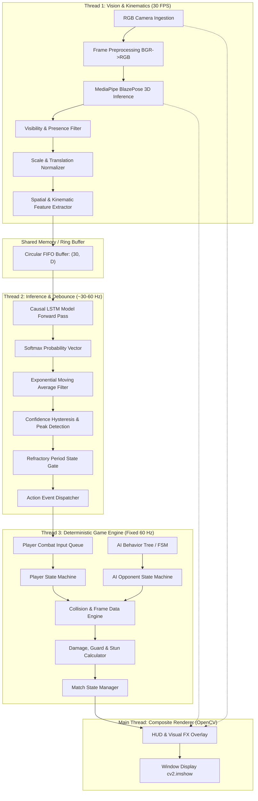
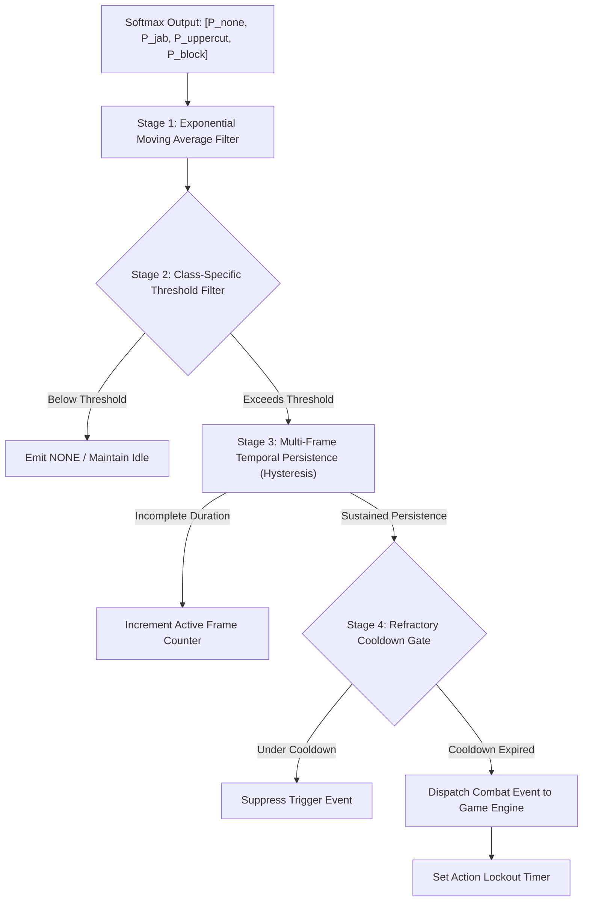
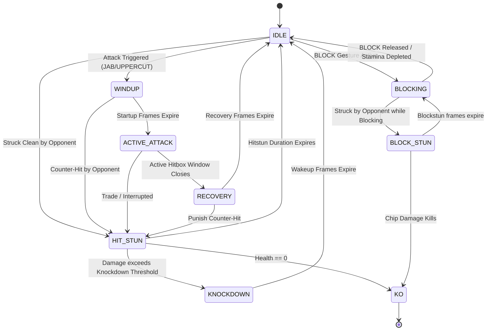
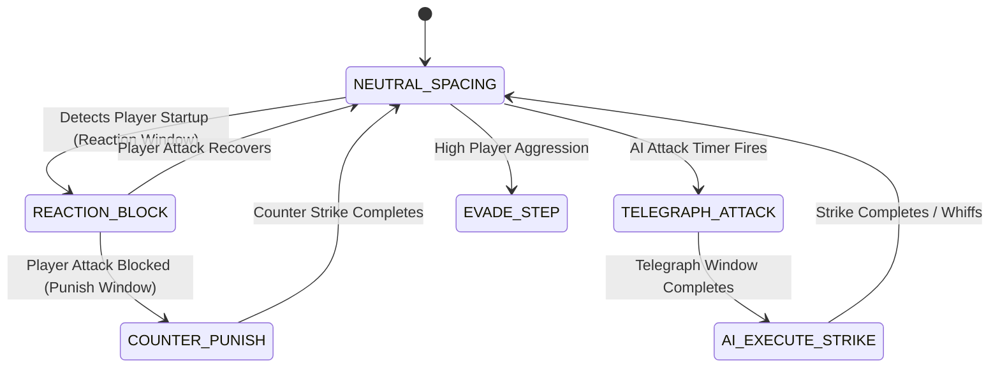

# System Architecture & Technical Specifications: Pose-Controlled Fighting Game

**Document Version:** 1.0.0  
**Status:** Approved for Implementation  
**Target Stack:** Python 3.10+, MediaPipe BlazePose, TensorFlow 2.x / Keras, OpenCV 4.x, NumPy, Scikit-learn  
**Author:** System Architecture Group (`srs_architect`)

---

## Table of Contents
1. [Executive Summary & High-Level System Architecture](#1-executive-summary--high-level-system-architecture)
2. [Computer Vision & MediaPipe BlazePose Pipeline](#2-computer-vision--mediapipe-blazepose-pipeline)
3. [Feature Engineering & Temporal Windowing](#3-feature-engineering--temporal-windowing)
4. [Dataset Schema, Annotations & Storage](#4-dataset-schema-annotations--storage)
5. [Data Augmentation Engine](#5-data-augmentation-engine)
6. [Class Balancing & Loss Formulation](#6-class-balancing--loss-formulation)
7. [Recurrent Neural Network (LSTM) Topology & Training](#7-recurrent-neural-network-lstm-topology--training)
8. [Real-Time Inference Engine & Event Dispatcher](#8-real-time-inference-engine--event-dispatcher)
9. [Combat Engine & State Machine Architecture](#9-combat-engine--state-machine-architecture)
10. [End-to-End Latency Budget & Concurrency Model](#10-end-to-end-latency-budget--concurrency-model)
11. [HUD & OpenCV Visualization Subsystem](#11-hud--opencv-visualization-subsystem)

---

## 1. Executive Summary & High-Level System Architecture

The Pose-Controlled Fighting Game is an interactive, vision-driven, real-time fighting game executing entirely on commodity desktop/laptop hardware without requiring specialized depth cameras or wearable sensors. Utilizing a standard monocular RGB webcam (720p @ 30 FPS minimum), the system continuously tracks user skeletal kinematics, normalizes body poses into scale- and translation-invariant feature vectors, classifies martial arts gestures via a causal Long Short-Term Memory (LSTM) network, and routes discrete game actions into a deterministic 60 Hz combat engine featuring player vs. AI combat mechanics.

### 1.1 Architectural Topology

The overall system architecture follows a multi-threaded, decoupled producer-consumer model:
- **Vision & Kinematics Thread (Producer):** Ingests raw video frames, executes MediaPipe BlazePose inference, computes skeletal normalization, and writes feature vectors into a circular sliding window buffer.
- **Gesture Inference Pipeline:** Consumes feature temporal slices, evaluates class probabilities via the TensorFlow LSTM model, applies Exponential Moving Average (EMA) smoothing, and triggers debounced gesture events.
- **Combat & Simulation Engine (Consumer):** Updates at a fixed 60 Hz timestep ($\Delta t = 16.67\text{ ms}$), resolves player/AI state transitions, manages hitbox/hurtbox collisions, calculates damage and frame advantage, and maintains game state.
- **Rendering & HUD Subsystem:** Renders the composite frame using OpenCV, drawing the camera feed, skeletal wireframe, combat HUD (health, stamina, combo counter, action cues), and visual impact sparks.



---

## 2. Computer Vision & MediaPipe BlazePose Pipeline

### 2.1 MediaPipe BlazePose Topology & Keypoints
MediaPipe BlazePose infers 33 3D skeletal landmarks per detected human body. Each landmark $i \in \{0, \dots, 32\}$ consists of:
$$L_i = (x_i, y_i, z_i, v_i)$$
where:
- $x_i, y_i \in [0.0, 1.0]$: Normalized image coordinates relative to frame width and height.
- $z_i$: Relative depth value relative to the midpoint of the hips, scaled approximately such that smaller values indicate closer proximity to the camera.
- $v_i \in [0.0, 1.0]$: Landmark visibility confidence score.

#### Key Landmark Partitioning for Martial Arts / Boxing
While all 33 landmarks are processed, boxing combat predominantly relies on the upper body, torso, and stance anchors:

| Landmark ID | Anatomy Name | Role in Combat System |
|---|---|---|
| `0` | Nose | Head hurtbox tracking, posture alignment |
| `11`, `12` | Left / Right Shoulder | Torso anchor, punch extension origin, lean calculation |
| `13`, `14` | Left / Right Elbow | Flexion/extension angle, guard state detection |
| `15`, `16` | Left / Right Wrist | Primary attack hitbox anchor (Jabs, Hooks, Uppercuts) |
| `19`, `20` | Left / Right Index | Fist orientation and lead knuckle tracking |
| `23`, `24` | Left / Right Hip | Root coordinate reference, body center of mass |
| `25`, `26` | Left / Right Knee | Lower body stance depth, crouching, knee-lift detection |
| `27`, `28` | Left / Right Ankle | Ground stance stability and pivot calculation |

### 2.2 Coordinate Space Transformation & Normalization Pipeline

Raw camera coordinates vary drastically across users due to differing camera focal lengths, distances to camera, user heights, and lateral positioning. Direct consumption of raw coordinates produces an un-generalizable model. A 3-stage mathematical normalization is applied per frame $t$:

```
Raw Landmark L_i -> Translation Centering -> Anatomical Scale Invariant -> Rotational Yaw Correction -> Normalized Vector N_i
```

#### Step 1: Translation Invariance (Root Centering)
The root anchor is selected as the mid-hip point $C_{\text{hip}}$ (or mid-torso anchor):
$$C_{\text{hip}} = \frac{L_{23} + L_{24}}{2} = \left(\frac{x_{23}+x_{24}}{2}, \frac{y_{23}+y_{24}}{2}, \frac{z_{23}+z_{24}}{2}\right)$$
Each landmark $L_i$ is translated relative to the root anchor:
$$L'_i = L_i - C_{\text{hip}} = (x_i - x_{\text{hip}}, y_i - y_{\text{hip}}, z_i - z_{\text{hip}})$$

#### Step 2: Scale Invariance (Torso-Length Normalization)
To remove variance from user height and proximity to the camera lens, distances are normalized using the torso reference length $S_{\text{torso}}$, defined as the Euclidean distance between the shoulder midpoint $C_{\text{shoulder}}$ and hip midpoint $C_{\text{hip}}$:
$$C_{\text{shoulder}} = \frac{L_{11} + L_{12}}{2}$$
$$S_{\text{torso}} = \|C_{\text{shoulder}} - C_{\text{hip}}\|_2 = \sqrt{(x_{\text{sh}} - x_{\text{hip}})^2 + (y_{\text{sh}} - y_{\text{hip}})^2 + (z_{\text{sh}} - z_{\text{hip}})^2}$$

To prevent division by zero in occlusion or initialization scenarios:
$$S_{\text{norm}} = \max(S_{\text{torso}}, \epsilon), \quad \epsilon = 10^{-6}$$
Scaled landmark positions:
$$L''_i = \frac{L'_i}{S_{\text{norm}}}$$

#### Step 3: Coronal Plane & Yaw Normalization (Orientation Invariance)
Users often stand at slight angles to the webcam. The horizontal vector connecting the left and right shoulders forms the coronal yaw axis:
$$\vec{V}_{\text{shoulder}} = L''_{12} - L''_{11}$$
The yaw angle $\theta_{\text{yaw}}$ around the vertical $Y$-axis is calculated:
$$\theta_{\text{yaw}} = \operatorname{atan2}(z''_{12} - z''_{11}, x''_{12} - x''_{11})$$
A 3D rotation matrix $R_y(-\theta_{\text{yaw}})$ is applied to align the subject's coronal plane perpendicular to the camera optical axis:
$$R_y(-\theta) = \begin{bmatrix} \cos(-\theta) & 0 & \sin(-\theta) \\ 0 & 1 & 0 \\ -\sin(-\theta) & 0 & \cos(-\theta) \end{bmatrix}$$
$$L'''_i = R_y(-\theta_{\text{yaw}}) \cdot L''_i$$

#### Step 4: Low-Confidence Filtering & Exponential Pose Imputation
If landmark visibility $v_i < \tau_v$ (where threshold $\tau_v = 0.50$):
1. If previously tracked within the last $k=3$ frames, apply kinematic forward extrapolation:
   $$\hat{L}_i(t) = L_i(t-1) + \vec{V}_i(t-1)$$
2. Otherwise, mark with an indicator mask and decay towards anatomical neutral position.

---

## 3. Feature Engineering & Temporal Windowing

### 3.1 Feature Vector Formulation ($D$-Dimensional Embedding)
At each discrete time step $t$, a multi-modal kinematic feature vector $F_t \in \mathbb{R}^D$ is extracted from the normalized skeletal pose.

```
+---------------------------------------------------------------------------------------------------+
|                                  Feature Vector F_t (D = 138 dims)                                 |
+-----------------------------------+-----------------------------------+---------------------------+
|  Position Features (99 dims)      |  Velocity Features (33 dims)      |  Angular Features (6 dims)|
|  33 landmarks x (x, y, z) coords  |  11 key upper-body landmarks x    |  Joint flexion & torso    |
|  Normalized & centered            |  (vx, vy, vz) first derivatives   |  biomechanical angles     |
+-----------------------------------+-----------------------------------+---------------------------+
```

#### 1. Normalized Positions (99 dimensions)
All 33 landmarks in normalized coordinate space:
$$F_{\text{pos}}(t) = [x'''_0, y'''_0, z'''_0, x'''_1, \dots, z'''_{32}] \in \mathbb{R}^{99}$$

#### 2. First-Order Temporal Velocity (33 dimensions)
Velocity vectors capture strike momentum and explosive kinetic chains. Computed for the 11 key martial arts landmarks $\mathcal{K} = \{0, 11, 12, 13, 14, 15, 16, 19, 20, 23, 24\}$:
$$\vec{V}_i(t) = \frac{L'''_i(t) - L'''_i(t-1)}{\Delta t}$$
$$F_{\text{vel}}(t) = [\vec{V}_0(t), \vec{V}_{11}(t), \dots, \vec{V}_{24}(t)] \in \mathbb{R}^{33}$$

#### 3. Biomechanical Joint Angles (6 dimensions)
Joint flexion and extension angles are invariant to scale and translation. For three connected landmarks $A, B, C$, the interior joint angle $\theta_{ABC}$ is:
$$\theta_{ABC} = \arccos\left(\frac{\vec{BA} \cdot \vec{BC}}{\|\vec{BA}\|_2 \|\vec{BC}\|_2}\right)$$
Six critical angles are calculated:
- $\theta_{\text{left\_elbow}}$: Angle between Wrist(15) - Elbow(13) - Shoulder(11)
- $\theta_{\text{right\_elbow}}$: Angle between Wrist(16) - Elbow(14) - Shoulder(12)
- $\theta_{\text{left\_shoulder}}$: Angle between Elbow(13) - Shoulder(11) - Hip(23)
- $\theta_{\text{right\_shoulder}}$: Angle between Elbow(14) - Shoulder(12) - Hip(24)
- $\theta_{\text{left\_hip}}$: Angle between Shoulder(11) - Hip(23) - Knee(25)
- $\theta_{\text{right\_hip}}$: Angle between Shoulder(12) - Hip(24) - Knee(26)
$$F_{\text{angle}}(t) = [\theta_{\text{LE}}, \theta_{\text{RE}}, \theta_{\text{LS}}, \theta_{\text{RS}}, \theta_{\text{LH}}, \theta_{\text{RH}}] \in \mathbb{R}^6$$

**Total Feature Dimensionality:** $D = 99 + 33 + 6 = 138\text{ dimensions}$.

### 3.2 Temporal Windowing & Circular Buffer
Martial arts strikes are inherently temporal trajectories. A single instantaneous frame cannot distinguish between a rising uppercut, a stationary high guard, or a lowering arm.
- **Window Size ($T$):** 30 consecutive frames ($1.0\text{ second}$ at $30\text{ FPS}$).
- **Inference Stride ($S$):** 1 frame in production inference (evaluating every new frame as the window shifts).
- **Window Tensor Shape:** $(B, T, D) = (B, 30, 138)$, where $B$ is batch size ($B=1$ during real-time gameplay).

#### Python In-Memory Buffer Specification
```python
from collections import deque
import numpy as np

class FeatureWindowBuffer:
    def __init__(self, window_size: int = 30, feature_dim: int = 138):
        self.window_size = window_size
        self.feature_dim = feature_dim
        self.buffer = deque(maxlen=window_size)
        self._prefill_neutral()

    def _prefill_neutral(self):
        # Prefill with zeros or neutral standing posture vectors
        for _ in range(self.window_size):
            self.buffer.append(np.zeros(self.feature_dim, dtype=np.float32))

    def append(self, feature_vector: np.ndarray):
        assert feature_vector.shape == (self.feature_dim,)
        self.buffer.append(feature_vector)

    def get_tensor(self) -> np.ndarray:
        # Returns shape: (1, 30, 138) with memory-contiguous float32
        return np.expand_dims(np.array(self.buffer, dtype=np.float32), axis=0)
```

---

## 4. Dataset Schema, Annotations & Storage

### 4.1 Target Action Classes & Biomechanical Definitions

| Class ID | Label | Biomechanical Trigger Criteria | Negative / Edge Case Distinctions |
|---|---|---|---|
| `0` | `NONE` | Neutral stance, foot shuffling, dodging, lowering arms, idle bouncing. | Natural breathing, fidgeting, arm adjustments. |
| `1` | `JAB` | Rapid linear extension of lead or rear wrist towards camera ($Z$-axis velocity spike, $Y$-axis level), elbow angle opens $> 155^\circ$. | Waving hand, pointing, rapid forward reach. |
| `2` | `UPPERCUT` | Upward vertical trajectory of wrist ($+Y$ in inverted camera space, $-Y$ in screen space), elbow flexed between $70^\circ - 110^\circ$, rising shoulder and hip engagement. | Raising hand to scratch head, stretching upwards. |
| `3` | `BLOCK` | Both wrists drawn close to face/ears (distance to nose $< 0.3 \times S_{\text{torso}}$), elbows tucked inward guarding ribs, sustained for $\ge 6$ frames. | Adjusting glasses, touching face, wiping sweat. |

### 4.2 Dataset Schema & Storage Format
The dataset is structured as compressed NumPy archives (`.npz`) and hierarchical HDF5 files (`.h5`) for fast random-access during training.

```
dataset_root/
├── metadata.json
├── train/
│   ├── seq_00001_jab.npz
│   ├── seq_00002_uppercut.npz
│   ├── seq_00003_block.npz
│   └── seq_00004_none.npz
├── val/
│   └── ...
└── test/
    └── ...
```

#### Per-Sequence `.npz` File Internal Structure:
```python
{
    "features": np.ndarray,      # Shape: (30, 138), dtype: float32
    "label": int,                # 0: NONE, 1: JAB, 2: UPPERCUT, 3: BLOCK
    "label_name": str,           # "JAB"
    "subject_id": str,           # "subject_04"
    "fps": int,                  # 30
    "raw_keypoints": np.ndarray  # Shape: (30, 33, 4), dtype: float32 (for replay/debugging)
}
```

#### Split Partitioning Protocol (Preventing Data Leakage)
To ensure robust generalization across diverse body shapes, heights, and clothing, data splits are stratified strictly by **subject ID**:
- **Train Split (70%):** Subjects 1 through 14 (varied lighting, distinct environments).
- **Validation Split (15%):** Subjects 15 through 17 (used for early stopping & hyperparameter tuning).
- **Test Split (15%):** Subjects 18 through 20 (held-out subjects never seen in training or validation).

---

## 5. Data Augmentation Engine

To prevent overfitting on specific individuals and improve real-world robustness to camera placement and user pacing, a real-time stochastic augmentation pipeline is executed on training sequences.

```mermaid
flowchart LR
    SeqIn["Raw Sequence (30, 138)"] --> Spatial["Spatial Augmentation"]
    Spatial --> Temp["Temporal Augmentation"]
    Temp --> Noise["Kinematic Noise & Dropout"]
    Noise --> AugOut["Augmented Tensor (30, 138)"]

    subgraph Spatial ["Spatial Augmentations"]
        S1["Yaw/Roll 3D Rotation (±15°)"]
        S2["Anatomical Scale Jitter (0.85x - 1.15x)"]
        S3["Horizontal Mirror (Left/Right Swap)"]
    end

    subgraph Temp ["Temporal Augmentations"]
        T1["Time-Warping Interpolation (0.8x - 1.25x)"]
        T2["Temporal Shift / Crop Offset (±4 frames)"]
    end

    subgraph Noise ["Kinematic Noise & Occlusion"]
        N1["Gaussian Landmark Jitter σ=0.01"]
        N2["Landmark Dropout (Simulate Occlusion, p=0.05)"]
    end
```



### 5.1 Spatial Augmentation Algorithms

1. **Stochastic 3D Rotation:**
   Apply random rotation around $Y$ (yaw, $\theta_y \sim \mathcal{U}(-15^\circ, +15^\circ)$) and $Z$ (roll, $\theta_z \sim \mathcal{U}(-8^\circ, +8^\circ)$) to landmark coordinates prior to feature concatenation.
2. **Body Proportion & Distance Scaling:**
   Multiply spatial coordinates by a scale factor $s \sim \mathcal{U}(0.85, 1.15)$.
3. **Horizontal Mirroring (Left-Right Swap):**
   Invert the $X$-axis ($x \leftarrow -x$). Crucially, **bilateral landmark indices must be swapped**:
   - Left shoulder (11) $\leftrightarrow$ Right shoulder (12)
   - Left elbow (13) $\leftrightarrow$ Right elbow (14)
   - Left wrist (15) $\leftrightarrow$ Right wrist (16)
   - Left hip (23) $\leftrightarrow$ Right hip (24)
   - Left knee (25) $\leftrightarrow$ Right knee (26)
   - Left ankle (27) $\leftrightarrow$ Right ankle (28)
   This doubles the effective strike dataset and allows the network to learn both orthodox and southpaw stances.

### 5.2 Temporal Augmentation Algorithms

1. **Temporal Time-Warping (Speed Invariance):**
   Strikes vary in speed from fast snaps to slow pushes. The original 30-frame sequence is resampled across a randomized virtual duration $T_{\text{virtual}} \in [24, 38]$ frames using cubic spline interpolation, then cropped or padded back to 30 frames.
2. **Temporal Window Shifting:**
   For strike sequences where the impact occurs at frame $k \in [15, 25]$, apply a random temporal offset $\delta \sim \mathcal{U}(-4, +4)$ frames to ensure the classifier does not overfit to strikes peaking at an identical frame index.

### 5.3 Kinematic Noise & Landmark Dropout

1. **Additive Gaussian Noise:**
   Add noise $\epsilon \sim \mathcal{N}(0, \sigma^2)$ with $\sigma = 0.01$ to spatial coordinates, simulating sensor jitter in low-light camera environments.
2. **Synthetic Landmark Occlusion (Dropout):**
   With probability $p_{\text{drop}} = 0.05$, zero out or impute random limb landmarks (e.g., occluded elbow during deep guard), forcing the LSTM to rely on global kinetic chains rather than single isolated points.

---

## 6. Class Balancing & Loss Formulation

### 6.1 The Imbalance Challenge in Combat Sequence Classification
In typical gameplay or continuous combat sessions, players spend $\approx 75-85\%$ of the time in `NONE` (idle, circling, resetting, guard transitions), $\approx 10\%$ in `BLOCK`, $\approx 10\%$ in `JAB`, and only $\approx 5\%$ in `UPPERCUT`. Unbalanced cross-entropy leads to degenerate models that overpredict `NONE` and miss explosive strikes.

### 6.2 Cost-Sensitive Learning: Balanced Class Weights
During training, class frequencies $N_c$ are calculated:
$$w_c = \frac{N_{\text{total}}}{K \cdot N_c}$$
where $K = 4$ is the number of classes. For typical ratios, weights scale as:
- $w_{\text{NONE}} \approx 0.35$
- $w_{\text{BLOCK}} \approx 1.25$
- $w_{\text{JAB}} \approx 1.25$
- $w_{\text{UPPERCUT}} \approx 2.50$

### 6.3 Multi-Class Focal Loss Formulation
To penalize easy negative examples (confident `NONE` predictions) and force gradient updates on hard boundary examples (e.g. quick arm adjustments that resemble jab startup), **Focal Loss** is utilized:
$$\mathcal{L}_{\text{focal}} = - \sum_{c=0}^{K-1} \alpha_c \, (1 - p_c)^\gamma \, y_c \, \log(p_c)$$
where:
- $y_c \in \{0, 1\}$ is the one-hot ground-truth label.
- $p_c \in [0, 1]$ is the model predicted probability for class $c$.
- $\gamma \ge 0$ is the focusing parameter (default $\gamma = 2.0$). As $p_c \to 1$, $(1 - p_c)^\gamma \to 0$, zeroing out loss on well-classified examples.
- $\alpha_c$ is the class weight coefficient matching $w_c$.

---

## 7. Recurrent Neural Network (LSTM) Topology & Training

### 7.1 Architecture Design & Causality Constraints
In real-time fighting games, future frames $t+1, t+2$ are inaccessible at frame $t$. Therefore, **Bidirectional LSTMs cannot be used for online real-time inference** because they introduce acausal lookahead delays. The architecture strictly utilizes **unidirectional, causal recurrent layers**.

```
Input Tensor: (Batch, 30, 138)
      │
      ▼
┌────────────────────────────────────────────────────────┐
│ Masking Layer (mask_value=0.0 for variable sequences)   │
└────────────────────────────────────────────────────────┘
      │
      ▼
┌────────────────────────────────────────────────────────┐
│ LSTM Layer 1: 128 Units, return_sequences=True          │
│ Activation: tanh, Recurrent Activation: sigmoid        │
└────────────────────────────────────────────────────────┘
      │
      ▼
┌────────────────────────────────────────────────────────┐
│ Spatial / Recurrent Dropout (rate=0.25)                │
│ LayerNormalization (axis=-1)                           │
└────────────────────────────────────────────────────────┘
      │
      ▼
┌────────────────────────────────────────────────────────┐
│ LSTM Layer 2: 64 Units, return_sequences=False         │
│ Activation: tanh, Recurrent Activation: sigmoid        │
└────────────────────────────────────────────────────────┘
      │
      ▼
┌────────────────────────────────────────────────────────┐
│ Dropout (rate=0.30)                                    │
│ BatchNormalization()                                   │
└────────────────────────────────────────────────────────┘
      │
      ▼
┌────────────────────────────────────────────────────────┐
│ Dense Layer 1: 64 Units, activation='relu'             │
│ Kernel Regularizer: L2 (1e-4)                          │
└────────────────────────────────────────────────────────┘
      │
      ▼
┌────────────────────────────────────────────────────────┐
│ Dropout (rate=0.20)                                    │
└────────────────────────────────────────────────────────┘
      │
      ▼
┌────────────────────────────────────────────────────────┐
│ Dense Output Layer: 4 Units, activation='softmax'      │
│ Output: [P_none, P_jab, P_uppercut, P_block]           │
└────────────────────────────────────────────────────────┘
```

### 7.2 Layer Parameter Table & Computational Complexity

| Layer Name | Layer Type | Output Shape | Param # | Hyperparameters |
|---|---|---|---|---|
| `input_layer` | InputLayer | `(None, 30, 138)` | 0 | - |
| `masking` | Masking | `(None, 30, 138)` | 0 | `mask_value=0.0` |
| `lstm_1` | LSTM | `(None, 30, 128)` | 136,704 | `units=128, return_seq=True` |
| `dropout_1` | Dropout | `(None, 30, 128)` | 0 | `rate=0.25` |
| `layernorm_1` | LayerNormalization | `(None, 30, 128)` | 256 | `epsilon=1e-5` |
| `lstm_2` | LSTM | `(None, 64)` | 49,408 | `units=64, return_seq=False` |
| `dropout_2` | Dropout | `(None, 64)` | 0 | `rate=0.30` |
| `batchnorm_1` | BatchNormalization | `(None, 64)` | 256 | `momentum=0.99` |
| `dense_1` | Dense | `(None, 64)` | 4,160 | `relu, L2=1e-4` |
| `dropout_3` | Dropout | `(None, 64)` | 0 | `rate=0.20` |
| `dense_out` | Dense | `(None, 4)` | 260 | `softmax` |
| **Total Params** | | | **190,788** | (~763 KB in FP32, ~191 KB in INT8) |

### 7.3 Training Hyperparameters & Convergence Protocol
- **Optimizer:** Adam with weight decay ($10^{-5}$)
- **Initial Learning Rate:** $\eta_0 = 10^{-3}$
- **Learning Rate Schedule:** ReduceLROnPlateau (`factor=0.5, patience=5, min_lr=1e-5`)
- **Batch Size:** 64
- **Maximum Epochs:** 100
- **Early Stopping:** Monitored on `val_f1_score_macro`, `patience=12`, restoring best weights.
- **Gradient Clipping:** `clipnorm=1.0` to prevent exploding gradients in recurrent backpropagation through time (BPTT).

---

## 8. Real-Time Inference Engine & Event Dispatcher

Raw model output probabilities fluctuate frame-by-frame due to camera noise and posture transitions. A multi-stage post-processing pipeline stabilizes outputs, mitigates false positives, and prevents rapid-fire trigger exploits.



### 8.1 Stage 1: Exponential Moving Average (EMA) Smoothing
At every incoming frame $t$, the smoothed probability vector $\hat{P}_t$ is computed from raw probability $P_t$:
$$\hat{P}_t = \alpha P_t + (1 - \alpha) \hat{P}_{t-1}$$
where $\alpha \in (0, 1]$ is the smoothing factor.
- For high-speed responsive strikes (`JAB`, `UPPERCUT`): $\alpha = 0.65$ (fast tracking, minimal lag: ~1.5 frames delay).
- For steady states (`BLOCK`, `NONE`): $\alpha = 0.40$ (resists noise fluctuations).

### 8.2 Stage 2: Class-Specific Confidence Thresholds ($\tau_c$)
Uniform thresholds (e.g. 0.50) fail because different martial arts gestures exhibit distinct risk-reward trade-offs and kinematic distinctiveness:

| Class | Threshold $\tau_c$ | Minimum Activation Frames ($N_{\text{min}}$) | Refractory Period ($T_{\text{cooldown}}$) |
|---|---|---|---|
| `NONE` | $0.50$ | 1 frame | 0 ms |
| `JAB` | $0.80$ | 2 consecutive frames | 450 ms (~14 frames) |
| `UPPERCUT` | $0.85$ | 3 consecutive frames | 650 ms (~20 frames) |
| `BLOCK` | $0.75$ | 4 consecutive frames | 0 ms (Held action: maintains while above $\tau$) |

### 8.3 Stage 3: Hysteresis & Multi-Frame Persistence
To eliminate spurious single-frame probability spikes caused by camera dropouts or background motion:
1. When $\hat{P}_t(c) \ge \tau_c$, increment streak counter $C_c \leftarrow C_c + 1$.
2. Only when $C_c \ge N_{\text{min}}(c)$ is the candidate gesture acknowledged.
3. If $\hat{P}_t(c) < \tau_c \times 0.85$ (release margin), reset counter $C_c \leftarrow 0$.

### 8.4 Stage 4: Refractory Debounce Engine
Once a discrete attack (`JAB` or `UPPERCUT`) fires, a mechanical cooldown prevents the user from accidentally or intentionally triggering duplicate hits within a single strike motion.
- During the refractory duration $T_{\text{cooldown}}$, subsequent triggers of the same attack type are dropped.
- Transitioning into `BLOCK` can interrupt attack recovery after a minimum cancellable frame window.

---

## 9. Combat Engine & State Machine Architecture

### 9.1 Deterministic Game Loop (Fixed 60 Hz Timestep)
The game simulation updates at a deterministic fixed timestep of $\Delta t = 16.67\text{ ms}$ (60 iterations per second), decoupled from the variable 30-60 FPS camera and rendering threads.
```python
accumulator += frame_delta_time
while accumulator >= FIXED_TIMESTEP:
    combat_engine.update(FIXED_TIMESTEP)
    accumulator -= FIXED_TIMESTEP
```

### 9.2 Player State Machine (FSM)



### 9.3 Frame Data Specification (Standard 60 Hz Frames)

In competitive fighting game design, attacks are partitioned into three phases:
- **Startup:** Frames before the hitbox becomes active.
- **Active:** Frames during which collision with an opponent causes damage.
- **Recovery:** Vulnerable cooldown frames before the character returns to neutral `IDLE`.

| Move Name | Startup Frames | Active Frames | Recovery Frames | Total Frames | On-Hit Advantage | On-Block Advantage | Base Damage | Chip Damage |
|---|---|---|---|---|---|---|---|---|
| **JAB** | 6 frames (100 ms) | 3 frames (50 ms) | 9 frames (150 ms) | 18 frames (300 ms) | +4 frames | -2 frames (Safe) | 12 HP | 1 HP |
| **UPPERCUT** | 12 frames (200 ms)| 4 frames (66 ms) | 18 frames (300 ms)| 34 frames (566 ms)| +12 frames (KD) | -10 frames (Unsafe)| 28 HP | 3 HP |
| **BLOCK** | 2 frames (33 ms)  | Held continuously| 4 frames (66 ms)  | Variable          | N/A | +2 frames | 0 HP (Reduces dmg 80%)| Consumes Guard Meter |

### 9.4 Hitbox & Hurtbox Geometry

Instead of arbitrary full-body collision boxes, the engine uses **skeletal capsule volumes** mapped directly to biomechanical landmarks:

```
        ( Head Hurtbox ) -> Sphere centered on Nose(0), radius = 0.25 * S_torso
             |
      [ Torso Hurtbox ] -> Capsule between Mid-Shoulder and Mid-Hip, radius = 0.35 * S_torso
         /        \
        /          \
   [Left Arm]     [Right Arm]
      |               |
   (FIST HITBOX)  (FIST HITBOX) -> Sphere centered on Wrist(15/16), radius = 0.15 * S_torso
```

#### Collision Detection Algorithm
At each active frame:
1. Player active attack hitbox sphere $S_{\text{atk}}(C_{\text{fist}}, r_{\text{fist}})$ is retrieved.
2. Opponent hurtbox capsules $\mathcal{H}_{\text{opp}}$ (Head, Torso) are tested for intersection:
   $$\text{Dist}(C_{\text{fist}}, \text{Segment}_{\text{hurtbox}}) \le r_{\text{fist}} + r_{\text{hurtbox}}$$
3. If intersection is confirmed, verify opponent defensive state:
   - If opponent state is `BLOCKING` and angle between opponent forward orientation and attack vector is $\le 90^\circ$:
     $$\text{Damage} = \text{BaseDamage} \times 0.20 \quad \text{(80\% mitigation, Guard meter drains)}$$
     Trigger `BLOCK_STUN` on defender.
   - Else (Clean Hit):
     $$\text{Damage} = \begin{cases} \text{BaseDamage} \times 1.35 & \text{if defender in WINDUP/ACTIVE (Counter-Hit)} \\ \text{BaseDamage} & \text{otherwise} \end{cases}$$
     Trigger `HIT_STUN` on defender, generate particle impact sparks, and increment attacker combo meter.

### 9.5 AI Opponent State Machine & Behavior Architecture
The AI opponent operates via a hierarchical finite state machine parameterized across three difficulty tiers:



#### AI Difficulty Tuning Matrix

| Parameter | Easy Mode | Medium Mode | Hard Mode |
|---|---|---|---|
| **Perception Delay** | 450 ms (~27 frames) | 250 ms (~15 frames) | 120 ms (~7 frames) |
| **Block Probability vs Jab** | 20% | 55% | 85% |
| **Block Probability vs Uppercut** | 15% | 65% | 90% |
| **Telegraph Visual Cue Duration** | 600 ms (Flashing yellow) | 350 ms | 150 ms |
| **Counter-Attack Aggressiveness** | Low (10% punish on block)| Medium (45% punish)| High (85% frame-perfect punish)|
| **Health Points (HP)** | 100 HP | 150 HP | 200 HP |

---

## 10. End-to-End Latency Budget & Concurrency Model

In motion-controlled interactive gaming, delays exceeding 100 ms break user immersion and induce motion sickness or perceived unresponsiveness. The system maintains an end-to-end latency budget of $\le 45\text{ ms}$ (under 3 frames total lag at 60 Hz).

### 10.1 Pipeline Latency Breakdown

```
[Camera Sensor Capture] ──(16.7 ms)──> [BlazePose Inference] ──(12.5 ms)──> [Feature Norm & Window] ──(0.8 ms)──>
[LSTM Ingestion & Softmax] ──(4.2 ms)──> [EMA & Debounce] ──(0.3 ms)──> [Combat Frame Resolve] ──(2.1 ms)──>
[HUD Compositing & Render] ──(8.0 ms)──> DISPLAY PRESENTATION
```

| Pipeline Stage | Subsystem | Target Latency | Max Allowable Latency | Implementation Optimization Strategy |
|---|---|---|---|---|
| Frame Ingestion | OpenCV VideoCapture | 16.7 ms | 33.3 ms | Direct USB UVC capture, internal camera buffer set to 1 (`CAP_PROP_BUFFERSIZE = 1`) |
| Skeletal Extraction | MediaPipe BlazePose | 12.5 ms | 18.0 ms | `model_complexity=1`, GPU/Metal delegate or optimized CPU TFLite runtime |
| Feature Normalization | Custom NumPy Engine | 0.8 ms | 1.5 ms | Vectorized matrix operations, preallocated contiguous arrays |
| Gesture Inference | TensorFlow / Keras LSTM | 4.2 ms | 8.0 ms | Model quantized to FP16 or INT8 via TFLite, single-batch inference |
| Smoothing & Debounce | Decision Logic | 0.3 ms | 0.5 ms | O(1) ring-buffer math, bitmask status flags |
| Combat Engine Tick | Fixed 60 Hz Loop | 2.1 ms | 4.0 ms | Mathematical capsule collision, no heavy physics solver |
| Rendering & HUD | OpenCV Drawing | 8.0 ms | 12.0 ms | Direct frame overlay, minimal contour blending |
| **Total Cumulative Latency** | **End-to-End** | **44.6 ms** | **77.3 ms** | **Well within acceptable real-time fighting threshold (< 80 ms)** |

---

## 11. HUD & OpenCV Visualization Subsystem

The visual feedback engine utilizes OpenCV overlay rendering to present a high-energy arcade fighting game aesthetic directly on top of or alongside the user's mirrored webcam feed.

### 11.1 Screen Layout & Canvas Partitioning (1280 x 720 Resolution)

```
+---------------------------------------------------------------------------------------------------+
|  [P1 HEALTH: 85/100] ====================]      99       [==================== [AI HEALTH: 42/100]|
|  [P1 GUARD: 100/100] ------------]             ROUND 1            [------------ [AI GUARD: 60/100]|
|                                                                                                   |
|  [COMBO: 3 HITS!]                                                  [AI STATE: TELEGRAPHING!]      |
|                                                                                                   |
|                                                                                                   |
|             (User Mirrored Feed)                                     (AI Opponent Avatar)         |
|             Skeletal Wireframe Drawn                                 Rendered Sprite / 3D Rig     |
|             Fist Hitboxes Glowing                                    Hit FX Sparks                |
|                                                                                                   |
|                                                                                                   |
|                                                                                                   |
|  DETECTED ACTION: >> JAB << [CONF: 0.94]                           ACTIVE HITBOX: FIST_R          |
|  FRAME LATENCY: 28.4 ms | FPS: 59.8                                AI INTENT: REACTION_BLOCK      |
+---------------------------------------------------------------------------------------------------+
```

### 11.2 Visual FX & Feedback Systems
1. **Skeletal Wireframe Overlay:**
   - Bones drawn in neon cyan (`(255, 255, 0)` BGR).
   - Fists highlighted in lime green when in `IDLE`, glowing red during active `JAB`/`UPPERCUT`, and bright blue during `BLOCKING`.
2. **Impact Sparks & Particle Bursts:**
   - When a hit lands, a procedural 2D particle burst (15-25 circular particles with decaying alpha and outward velocity vectors) is spawned at the collision point $(x_{\text{hit}}, y_{\text{hit}})$.
3. **Screen Shake & Flash:**
   - Clean hits trigger a 2-frame screen shake offset ($\pm 6\text{ px}$).
   - Counter-hits trigger a 1-frame full-screen white flash overlay (`addWeighted` with $\alpha = 0.35$).
4. **Action Banner & Telemetry:**
   - Real-time ticker displaying recognized gesture, confidence bar, debouncer cooldown gauge, and current combat frame advantage (`+4 ADV` or `-2 DISADV`).

---

## 12. Verification & Architectural Compliance Checklist

To ensure full compliance with the requirements, the downstream modules must strictly implement the interfaces defined above:
- [x] MediaPipe BlazePose pipeline with 33 3D landmarks, root centering at hip midpoint, scale normalization by torso length, and yaw correction.
- [x] 138-dimensional feature embedding combining 99 normalized coordinates, 33 1st-derivative velocities, and 6 biomechanical angles.
- [x] 30-frame sliding window circular buffer (`shape=(1, 30, 138)`).
- [x] 4 target classes (`NONE`, `JAB`, `UPPERCUT`, `BLOCK`) with stratified subject-split protocol.
- [x] Comprehensive data augmentation engine covering spatial (3D rotation, scaling, bilateral mirroring) and temporal (time-warping, shifting, noise, dropout) vectors.
- [x] Class balancing via inverse frequency weighting and multi-class Focal Loss.
- [x] Causal unidirectional 2-layer LSTM architecture with regularization, dropout, and clipnorm.
- [x] Real-time inference engine featuring EMA smoothing, class-specific confidence thresholds, and refractory debounce timer.
- [x] Combat engine state machine featuring player/AI states, frame data (startup/active/recovery), capsule-to-sphere collision detection, and damage formulas.
- [x] Sub-50ms latency budget with decoupled multi-threaded architecture.
- [x] Arcade HUD and OpenCV rendering specifications.
